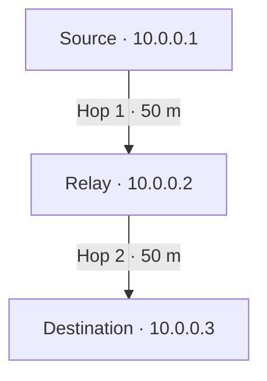
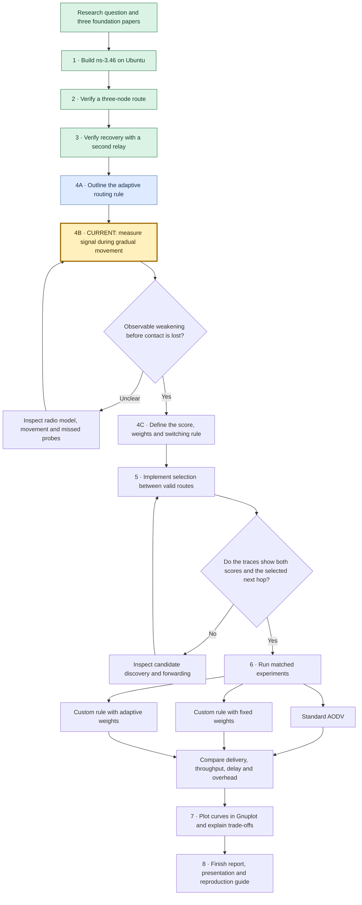

# Adaptive Routing in MANETs

COMP 5213 – Computer Networks · Group 8

**Status:** Three- and four-node AODV baselines verified. The adaptive rule is outlined. Step 4B is the next experiment.

## 1. Overview

Imagine three phones outdoors. The first can reach the middle phone by radio. The middle phone can reach the last. A **mobile ad hoc network (MANET)** lets devices forward messages for each other without a fixed access point. A **node** is one device, a **packet** is one small unit of data, and a **hop** is one transmission between neighboring devices.

**ns-3** is the program that models these devices, their radios, and the passage of time on one computer. **Ad hoc On-Demand Distance Vector (AODV)** is the routing protocol inside the model. When a sender needs a route, AODV can ask nearby nodes for a path. Each device records which neighbor should receive the packet next.

| Three-node UDP run | Sent | Received | Delivery |
|---|---:|---:|---:|
| Relay stays in place | 30 | 30 | 100% |
| Relay moves out of range at 10 s | 30 | 10 | 33.33% |

Both routing tables showed the same two-hop path at 8 seconds. The moving run demonstrates what happens when the only relay leaves. The research question comes next: when more than one path is available, can a mobility-aware routing decision improve delivery?

[Follow the setup, experiments, and results in the project log](docs/project-log.md)

### Four-node result

With both relays stationary, all 30 UDP packets arrived. When the active relay moved at 10 s, 29 of 30 arrived (96.67%). The source used gateway `10.0.0.2` at 8 s and `10.0.0.3` at 12 s. Packet 10 was lost. Packet 11 arrived at 11.507394 s. This measures the first observed delivery after movement; routing snapshots do not pinpoint the instant the replacement route was installed.

The three- and four-node demonstrations used different radio models. Interpret each moving run against its own stationary control.

### Project roadmap

Green marks verified work, blue marks the proposed design, and amber marks the current checkpoint. The final comparison uses the same radio model, movement traces, traffic and measurement window for all three methods.

## 2. Problem Statement

Standard routing protocols such as AODV discover routes when needed, but changing network conditions can cause established routes to fail.

Our project will investigate a route-selection mechanism that adjusts the importance of selected routing factors according to observed mobility conditions.

## 3. Objectives

- Establish a working MANET simulation using NS-3.
- Evaluate standard AODV as a baseline.
- Design and implement a lightweight adaptive route-selection mechanism.
- Investigate how mobility-dependent routing decisions affect network performance.
- Compare the proposed approach against the baseline under controlled simulation conditions.
- Analyze and document experimental results.

## 4. Proposed Approach

The proposed rule combines current link quality with an estimate of stability from recent signal observations. Step 4B will use a distance-dependent radio model, keep one relay stationary, move the other gradually, and record the signal strength and sequence number of probes received at the source. Its first deliverable is a plot of received power (dBm) against time (s) with one curve per relay.

After inspecting the pilot traces, define the observation window and weights. At route selection, compare valid candidates and record their scores and the next hop actually used. A strong first-hop signal alone cannot establish that the relay has a valid onward route.

## 5. Experimental evaluation

| Planned comparison | Output |
|---|---|
| Motion in the four-node network | Signal vs time, routing snapshots, packet arrivals and recovery timeline |
| Increasing node speed | Packet delivery or loss (%), application throughput (kb/s), end-to-end delay (ms), and routing overhead (control bytes/s) |
| Increasing node count or offered load | Throughput, delay and control traffic with the other settings held fixed |
| Energy, if a radio energy model is configured | Joules consumed and joules per delivered packet |

Record duration, measurement window, topology, channel width (MHz), radio data rate (Mb/s), offered load, mobility and repetitions. Save per-run CSVs and Gnuplot scripts. Label axes, units, legends and uncertainty across independent runs. The final report will connect each comparative figure to the settings that produced it.

## 6. Technology Stack

- **Operating system:** Ubuntu running in a virtual machine
- **Network simulation:** NS-3
- **Implementation:** C++
- **Analysis and visualization:** Gnuplot for evaluation figures, with Python for data preparation as needed
- **Version control:** Git and GitHub

## 7. Research Foundation

The initial literature review is guided by the following journal papers:

1. *An Adaptive Reinforcement Learning-Based Mobility-Aware Routing for Heterogeneous Wireless Body Area Networks* (2024).
2. *Topology Control Using Optimized Clustering Scheme in Mobile Ad Hoc Network* (2024).
3. *An Adaptive Congestion and Energy Aware Multipath Routing Scheme for Mobile Ad-Hoc Networks Through Stable Link Prediction* (2023).

These papers provide background on mobility-aware routing, topology control, link stability, and adaptive routing decisions. They will inform our design without being reproduced as complete implementations.

## 8. Project Status

- [x] GitHub repository created.
- [x] Project topic approved.
- [x] Ubuntu development environment verified.
- [x] ns-3.46 built and tested.
- [x] Three-node AODV baseline verified with ping and UDP.
- [x] Four-node baseline with an alternate relay (Step 3).
- [x] Initial adaptive routing design outlined (Step 4A).
- [ ] Received-signal trace and first Gnuplot curve (Step 4B).
- [ ] Adaptive mechanism implemented.
- [ ] Experiments completed and results analyzed.

## 9. Repository

Source code, documentation, and reproducible experiment configurations will be maintained in this repository as development progresses.
