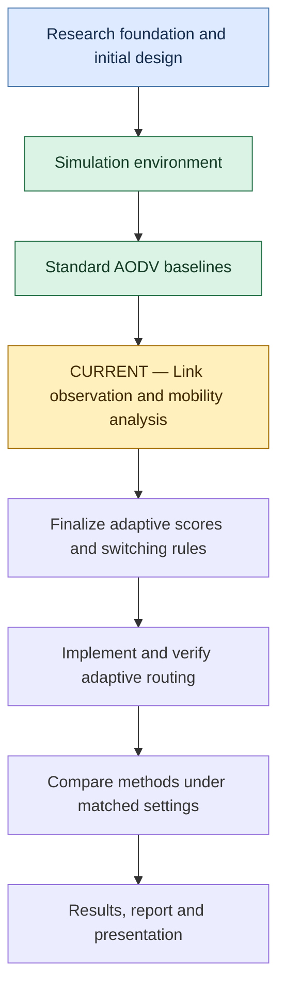
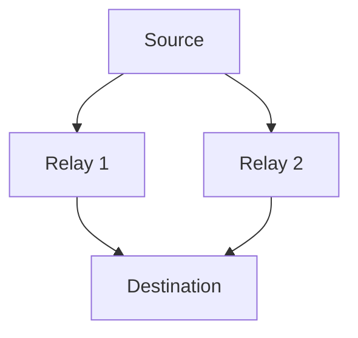
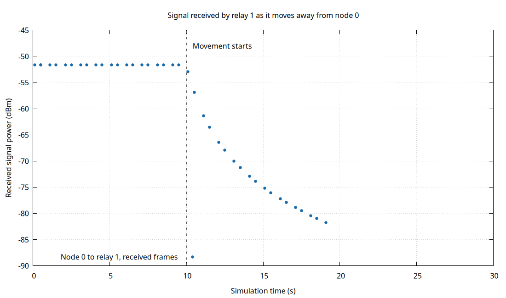

# Adaptive Routing in MANETs

**COMP 5213 — Computer Networks | Lakehead University | Group 8**

A simulation project investigating whether mobility-aware route selection
can improve packet delivery as wireless devices move.

**Current phase — Link Observation and Mobility Analysis**

The standard AODV baseline experiments and the first moving-link signal
plot are complete. The next experiment will measure signals from both
relay candidates at the sender. The adaptive routing mechanism is
currently in design.

## Understanding the Project

A **Mobile Ad Hoc Network (MANET)** is a wireless network in which devices
can move and forward packets for one another without a fixed access point.

| Term | Meaning in this project |
|---|---|
| Node | A simulated wireless device |
| Packet | A small unit of transmitted data |
| Source | The device sending application data |
| Destination | The device intended to receive that data |
| Relay | A device forwarding packets toward the destination |
| Hop | One transmission between neighboring devices |
| Route | The sequence of hops leading to the destination |
| ns-3 | The simulator used to model devices, radios, traffic, and movement |
| AODV | Ad hoc On-Demand Distance Vector, the baseline routing protocol |
| UDP | The transport protocol used to generate our application traffic |
| dBm | The unit used for received signal power |

AODV discovers routes when they are needed. As devices move, an existing
route may fail and another route may become necessary.

Our research question is whether observations of link quality and
stability can help a device select a suitable route as conditions change.

## Project Phases

| Phase | Purpose | Status |
|---|---|---|
| Research Foundation and Method Design | Connect the research question to the foundation papers and outline the proposed mechanism | Initial direction outlined; detailed design ongoing |
| Simulation Environment | Build ns-3 and establish the development workflow | Complete |
| Standard AODV Baselines | Observe delivery, route failure, and recovery in small networks | Initial demonstrations complete |
| Link Observation and Mobility Analysis | Measure signal changes during movement and compare relay candidates | **Current phase** |
| Adaptive Routing Implementation | Implement candidate scoring and make it control forwarding | Planned |
| Comparative Performance Evaluation | Compare standard AODV, fixed-weight selection, and adaptive-weight selection | Planned |
| Results and Research Communication | Produce reproducible figures, a report, and the final presentation | Planned |

## Research Foundation and Method Design

The project proposal identifies three foundation papers:

| Foundation paper | Intended contribution to the project |
|---|---|
| *An Adaptive Reinforcement Learning-Based Mobility-Aware Routing for Heterogeneous Wireless Body Area Networks* (2024) | Concepts related to mobility-aware decisions and link lifetime |
| *Topology Control Using Optimized Clustering Scheme in Mobile Ad Hoc Network* (2024) | Concepts related to changing topology and connectivity |
| *An Adaptive Congestion and Energy Aware Multipath Routing Scheme for Mobile Ad-Hoc Networks Through Stable Link Prediction* (2023) | Concepts related to link stability and route selection |

These are the titles supplied in the project proposal. Full bibliographic
references and detailed paper summaries remain part of the literature
documentation.

The proposed mechanism combines current link quality with an estimate
of stability derived from recent observations. It will adjust the
importance of these factors according to observed mobility conditions.

The detailed design will specify:

- What each node can measure locally.
- How observations become quality and stability scores.
- How weights change with observed conditions.
- How candidate routes are discovered and checked for validity.
- When a node changes its selected route.
- How extra measurement and control traffic is counted.

The planned contribution is a lightweight adaptive route-selection
mechanism built around AODV. Its effect on forwarding and network
performance remains to be implemented and evaluated.

[Read the adaptive routing design](docs/adaptive-routing-design.md)

## Simulation Environment

The project uses Ubuntu in a virtual machine, ns-3.46, C++, Git, and
Gnuplot.

The ns-3 launcher encountered a Python 3.14 argument-parsing error in
the development environment. Configuration and compilation currently
use CMake and Ninja directly.

| Location | Responsibility |
|---|---|
| `~/Projects/Adaptive-Routing-in-MANETs` | Project source, documentation, scripts, and results |
| `~/Projects/ns-3.46` | Simulator source and build output |
| ns-3 `scratch` directory | Symbolic links that make project simulations available to the build |

The environment was checked by building and running `hello-simulator`,
followed by the AODV examples and project simulations.

## Standard AODV Baselines

### Single Relay — Delivery and Route Failure

Three devices formed a route from the source, through a relay, to the
destination.

| Scenario | UDP sent | UDP received | Packet delivery ratio |
|---|---:|---:|---:|
| Relay stationary | 30 | 30 | 100% |
| Relay moved out of reach at 10 s | 30 | 10 | 33.33% |

At 8 s, both routing tables showed the same two-hop path. After the
only relay moved away, delivery stopped in the moving run.

### Alternate Relay — Route Recovery

A fourth device provided another possible relay.

The diagram shows the intended candidate paths.

| Scenario | UDP sent | UDP received | Packet delivery ratio |
|---|---:|---:|---:|
| Both relays stationary | 30 | 30 | 100% |
| Active relay moved at 10 s | 30 | 29 | 96.67% |

In the moving run:

- At 8 s, the source used gateway `10.0.0.2`.
- At 12 s, the source used gateway `10.0.0.3`.
- Packet 10 was lost.
- Packet 11 arrived at 11.507394 s.

The first observed delivery after movement occurred 1.507394 s later.
The routing snapshots establish that the next hop changed between the
recorded times. They do not identify the exact route-installation time.

The three-node and four-node demonstrations used different radio
models. Each moving run should be interpreted against its own
stationary control.

## Link Observation and Mobility Analysis

### Completed — Gradual Movement and Signal Measurement

The experiment in `simulations/relay-signal-trace.cc` uses:

- `LogDistancePropagationLossModel` to model distance-dependent signal loss.
- `ConstantVelocityMobilityModel` to move a relay gradually.
- Position snapshots to verify movement.
- `MonitorSnifferRx` to record successfully received Wi-Fi data frames.

Relay 1 starts 5 m from node 0. At 10 s, it begins moving along the
positive x-axis at 5 m/s.

| Experiment | UDP sent | UDP received | Packet delivery ratio |
|---|---:|---:|---:|
| Stationary relay at 61.03 m | 30 | 0 | 0% |
| Stationary relay at 5 m | 30 | 30 | 100% |
| Relay moving away from 5 m | 30 | 19 | 63.33% |

The stationary close-range test showed a direct one-hop route.
At 61.03 m, the sender's route remained `IN_SEARCH` at the inspected
snapshots.

### Observed Signal Changes

The signal trace records frames transmitted by node 0 and received
at relay 1.

| Observation | Recorded value |
|---|---|
| Received power before movement | Approximately −51.63 dBm |
| Last UDP packet delivered | Sequence 18 |
| Last UDP arrival time | 18.500314 s |
| Signal reading at that arrival | Approximately −80.96 dBm |
| Final received Wi-Fi frame time | 19.100170 s |
| Final signal reading | Approximately −81.76 dBm |
| Total received-signal samples | 40 |

The graph shows a steady signal before movement and decreasing
received power afterward. Signal weakening was observable while UDP
packets were still arriving.

Wi-Fi frame sequence numbers and UDP packet sequence numbers belong
to different layers. Wi-Fi data frames may also carry routing messages.
A final Wi-Fi reception can therefore occur after the final UDP arrival.

The trace contains samples from successfully received frames. An empty
interval means no sample was recorded. These single-run observations
will guide further experiments and threshold selection.

### Next — Observe Both Relays at the Sender

The sender needs observations of its candidate relays to make a
mobility-aware decision.

The next experiment will:

- Establish reachable starting positions for both relays.
- Send identifiable probes from each relay toward the source.
- Keep one relay stationary while the other moves gradually.
- Record reception time, relay identity, sequence number, and signal power.
- Plot one received-signal curve per relay in Gnuplot.
- Examine weakening signals and missing probes together.

This completes the next part of the measurement work needed to
finalize the adaptive selection rule.

## Adaptive Routing Implementation

AODV currently handles route discovery and forwarding.

The planned implementation will use the measurements to score valid
route candidates and adjust the weighting of quality and stability.
The design must also establish that each candidate has a valid onward
path to the destination.

Implementation verification will record:

- The observations available at the decision time.
- Candidate scores and weights.
- The selected next hop.
- The next hop actually used to forward packets.
- Route changes and their effect on delivery.

A fixed-weight version will provide an additional comparison for
evaluating the effect of changing weights.

## Comparative Performance Evaluation

The final experiments will compare:

- Standard AODV.
- The custom mechanism with fixed weights.
- The custom mechanism with adaptive weights.

All methods will use matched topology, radio settings, traffic,
movement traces, simulation duration, and measurement windows.
Experiments will include repeated runs with recorded random seeds.

| Evaluation metric | What it measures |
|---|---|
| Packet delivery ratio | Percentage of sent application packets received |
| Packet loss | Application packets that fail to arrive within the defined measurement procedure |
| Application throughput | Received application data per unit time |
| End-to-end delay | Time from application transmission to reception |
| Routing overhead | Control traffic required to establish and maintain routes |
| Delivery interruption | Gap in reception around a route disruption |
| Route changes | Frequency and timing of forwarding-path changes |
| Energy consumption | Radio energy used, once an energy model is configured |

Measurement definitions will specify units, observation windows,
treatment of undelivered packets, and whether overhead is measured
in packets, bytes, or transmissions.

### Planned Experiment Variables

| Variable | Planned analysis |
|---|---|
| Node speed | Delivery, delay, throughput, and overhead as mobility increases |
| Node count | Performance as the network grows |
| Offered traffic load | Performance as the amount of generated traffic increases |
| Mobility pattern | Effects of different movement conditions |
| Radio settings | Documented channel width, data rate, transmit power, and propagation model |
| Simulation duration | Recorded run length, traffic interval, and observation window |

Gnuplot figures will include axis labels, units, legends, and uncertainty
where repeated runs support it. The report will identify the network
settings behind each figure and explain both improvements and trade-offs.

Energy results require an explicitly configured radio energy model.

[Read the evaluation plan](docs/evaluation-plan.md)

## Results and Research Communication

The final report and presentation will bring together:

- The research problem and foundation-paper summaries.
- The proposed method, assumptions, and decision rules.
- Implementation details and evidence that the rule controls forwarding.
- Simulation settings and reproducible experiment commands.
- Comparisons with standard AODV and the fixed-weight mechanism.
- Gnuplot curves, metric definitions, and discussion of results.
- Limitations and possible future improvements.

## Repository Guide

| Path | Contents |
|---|---|
| `simulations/aodv-udp-baseline.cc` | Three-node UDP baseline |
| `simulations/aodv-four-node.cc` | Alternate-relay AODV experiment |
| `simulations/relay-signal-trace.cc` | Gradual movement and signal observations |
| `scripts/run-four-node.sh` | Four-node experiment runner |
| `plots/relay-signal.gp` | Received-signal figure instructions |
| `results/` | Trial logs, routing snapshots, measurements, and generated figures |
| `docs/project-log.md` | Detailed development and experiment history |
| `docs/adaptive-routing-design.md` | Proposed adaptive mechanism |
| `docs/evaluation-plan.md` | Evaluation requirements and experiment plan |

Graphs are stored alongside the measurements used to generate them.
The verified moving-link figure and its data are in
`results/relay-signal-trace/verified-moving-5m/`.

[Read the project log](docs/project-log.md)
