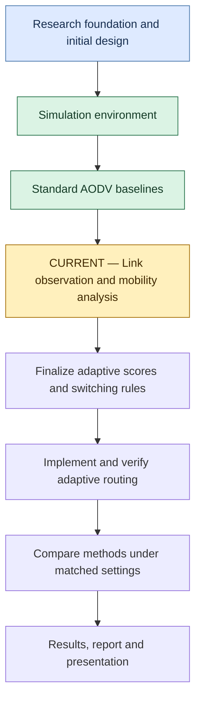
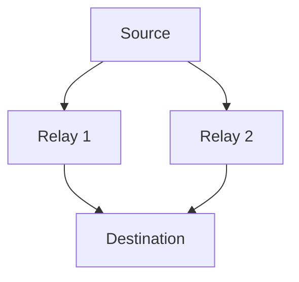
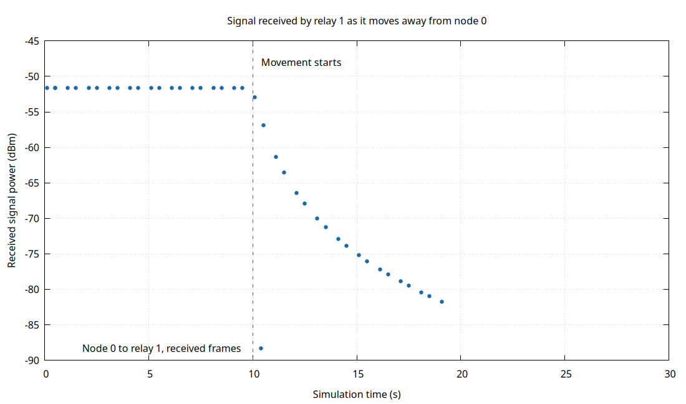
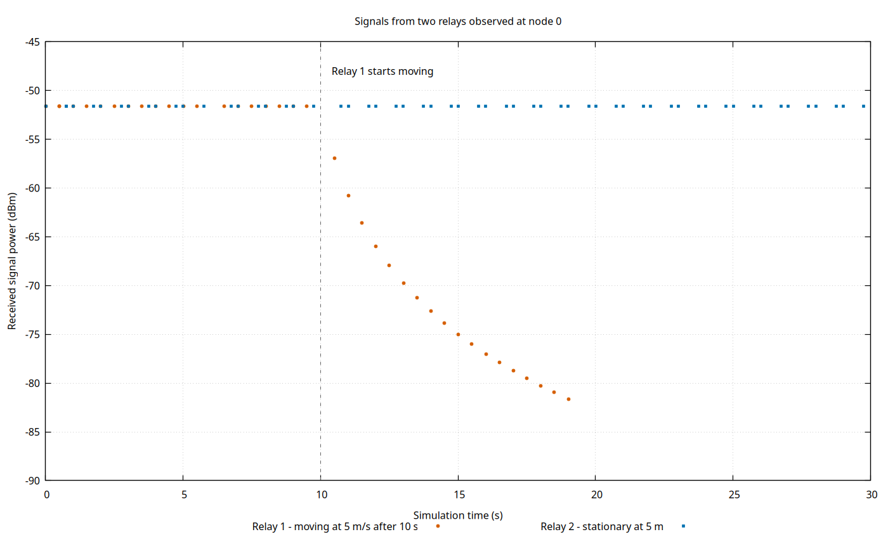
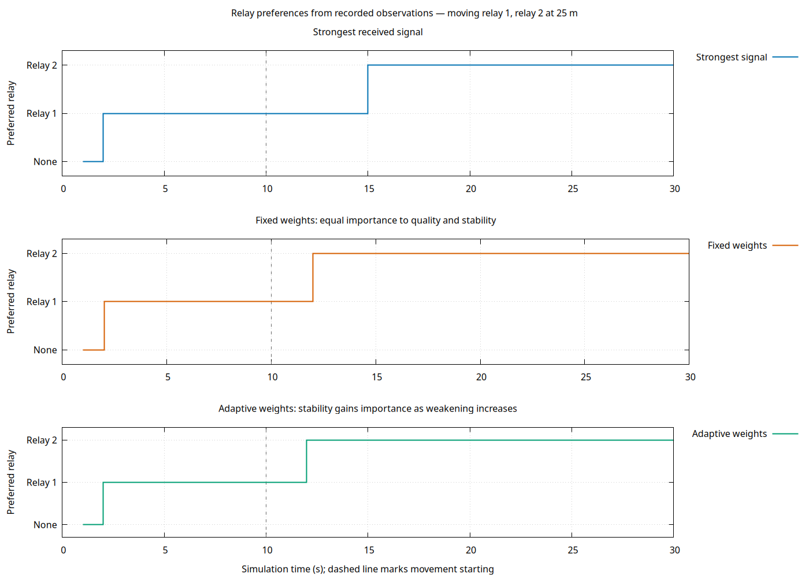
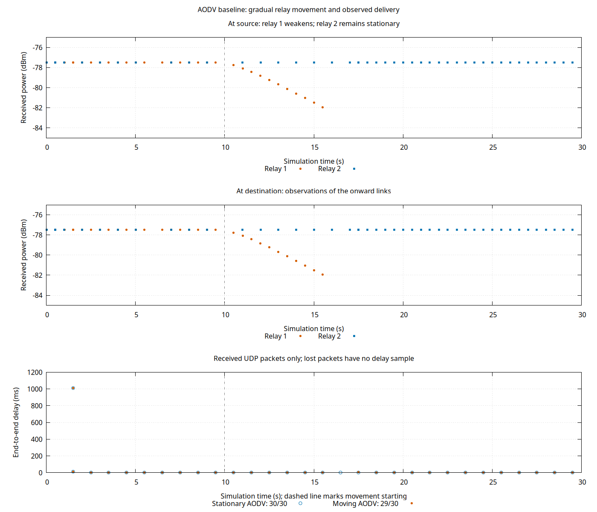
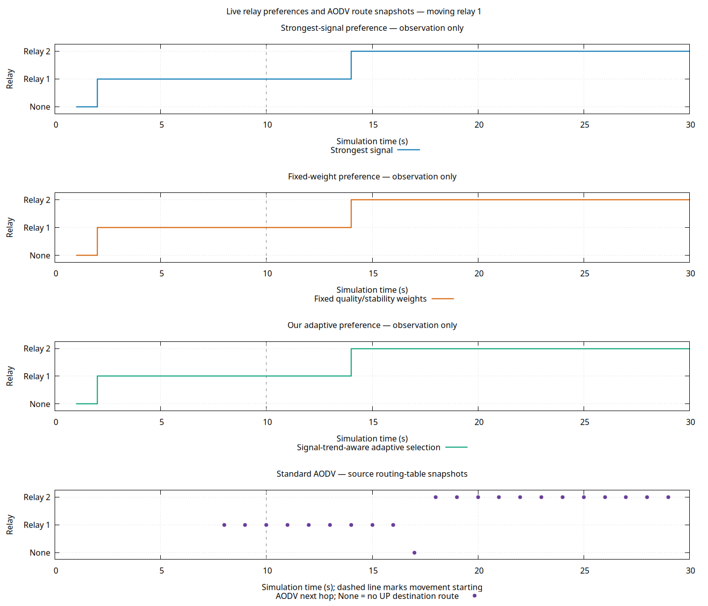
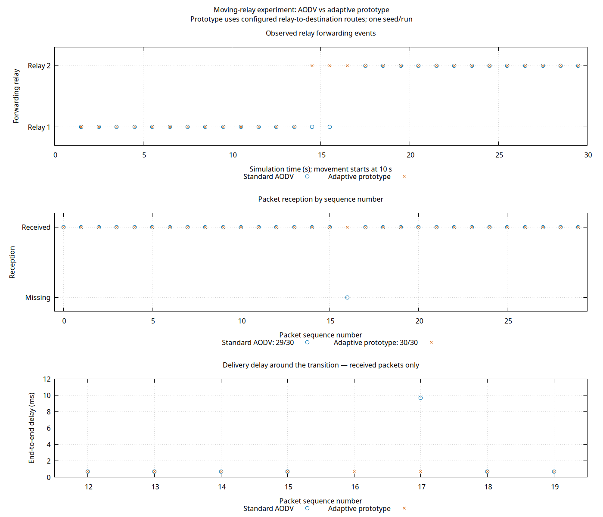

# Adaptive Routing in MANETs

**COMP 5213 — Computer Networks | Lakehead University | Group 8**

A simulation project investigating whether mobility-aware route selection
can improve packet delivery as wireless devices move.

**Current phase — Link Observation and Mobility Analysis**

The standard AODV baselines, moving-link signal plot, and two-relay
signal comparison at the sender are complete. The next task is to
define and validate candidate scores. The adaptive routing mechanism
is currently in design.

## Understanding the Project

A **Mobile Ad Hoc Network (MANET)** is a wireless network in which devices
can move and forward packets for one another without a fixed access point.

| Term | Meaning in this project |
|---|---|
| Node | A simulated wireless device |
| Packet | A small unit of transmitted data |
| Source | The device sending application data |
| Destination | The device intended to receive that data |
| Relay | A device forwarding packets toward the destination |
| Hop | One transmission between neighboring devices |
| Route | The sequence of hops leading to the destination |
| ns-3 | The simulator used to model devices, radios, traffic, and movement |
| AODV | Ad hoc On-Demand Distance Vector, the baseline routing protocol |
| UDP | The transport protocol used to generate our application traffic |
| dBm | The unit used for received signal power |

AODV discovers routes when they are needed. As devices move, an existing
route may fail and another route may become necessary.

Our research question is whether observations of link quality and
stability can help a device select a suitable route as conditions change.

## Project Phases

| Phase | Purpose | Status |
|---|---|---|
| Research Foundation and Method Design | Connect the research question to the foundation papers and outline the proposed mechanism | Initial direction outlined; detailed design ongoing |
| Simulation Environment | Build ns-3 and establish the development workflow | Complete |
| Standard AODV Baselines | Observe delivery, route failure, and recovery in small networks | Initial demonstrations complete |
| Link Observation and Mobility Analysis | Measure signal changes during movement and compare relay candidates | **Current phase** |
| Adaptive Routing Implementation | Implement candidate scoring and make it control forwarding | Planned |
| Comparative Performance Evaluation | Compare standard AODV, fixed-weight selection, and adaptive-weight selection | Planned |
| Results and Research Communication | Produce reproducible figures, a report, and the final presentation | Planned |

## Research Foundation and Method Design

The project proposal identifies three foundation papers:

| Foundation paper | Intended contribution to the project |
|---|---|
| *An Adaptive Reinforcement Learning-Based Mobility-Aware Routing for Heterogeneous Wireless Body Area Networks* (2024) | Concepts related to mobility-aware decisions and link lifetime |
| *Topology Control Using Optimized Clustering Scheme in Mobile Ad Hoc Network* (2024) | Concepts related to changing topology and connectivity |
| *An Adaptive Congestion and Energy Aware Multipath Routing Scheme for Mobile Ad-Hoc Networks Through Stable Link Prediction* (2023) | Concepts related to link stability and route selection |

These are the titles supplied in the project proposal. Full bibliographic
references and detailed paper summaries remain part of the literature
documentation.

The proposed mechanism combines current link quality with an estimate
of stability derived from recent observations. It will adjust the
importance of these factors according to observed mobility conditions.

The detailed design will specify:

- What each node can measure locally.
- How observations become quality and stability scores.
- How weights change with observed conditions.
- How candidate routes are discovered and checked for validity.
- When a node changes its selected route.
- How extra measurement and control traffic is counted.

The planned contribution is a lightweight adaptive route-selection
mechanism built around AODV. Its effect on forwarding and network
performance remains to be implemented and evaluated.

[Read the adaptive routing design](docs/adaptive-routing-design.md)

## Simulation Environment

The project uses Ubuntu in a virtual machine, ns-3.46, C++, Git, and
Gnuplot.

The ns-3 launcher encountered a Python 3.14 argument-parsing error in
the development environment. Configuration and compilation currently
use CMake and Ninja directly.

| Location | Responsibility |
|---|---|
| `~/Projects/Adaptive-Routing-in-MANETs` | Project source, documentation, scripts, and results |
| `~/Projects/ns-3.46` | Simulator source and build output |
| ns-3 `scratch` directory | Symbolic links that make project simulations available to the build |

The environment was checked by building and running `hello-simulator`,
followed by the AODV examples and project simulations.

## Standard AODV Baselines

### Single Relay — Delivery and Route Failure

Three devices formed a route from the source, through a relay, to the
destination.

| Scenario | UDP sent | UDP received | Packet delivery ratio |
|---|---:|---:|---:|
| Relay stationary | 30 | 30 | 100% |
| Relay moved out of reach at 10 s | 30 | 10 | 33.33% |

At 8 s, both routing tables showed the same two-hop path. After the
only relay moved away, delivery stopped in the moving run.

### Alternate Relay — Route Recovery

A fourth device provided another possible relay.

The diagram shows the intended candidate paths.

| Scenario | UDP sent | UDP received | Packet delivery ratio |
|---|---:|---:|---:|
| Both relays stationary | 30 | 30 | 100% |
| Active relay moved at 10 s | 30 | 29 | 96.67% |

In the moving run:

- At 8 s, the source used gateway `10.0.0.2`.
- At 12 s, the source used gateway `10.0.0.3`.
- Packet 10 was lost.
- Packet 11 arrived at 11.507394 s.

The first observed delivery after movement occurred 1.507394 s later.
The routing snapshots establish that the next hop changed between the
recorded times. They do not identify the exact route-installation time.

The three-node and four-node demonstrations used different radio
models. Each moving run should be interpreted against its own
stationary control.

## Link Observation and Mobility Analysis

### Completed — Gradual Movement and Signal Measurement

The experiment in `simulations/relay-signal-trace.cc` uses:

- `LogDistancePropagationLossModel` to model distance-dependent signal loss.
- `ConstantVelocityMobilityModel` to move a relay gradually.
- Position snapshots to verify movement.
- `MonitorSnifferRx` to record successfully received Wi-Fi data frames.

Relay 1 starts 5 m from node 0. At 10 s, it begins moving along the
positive x-axis at 5 m/s.

| Experiment | UDP sent | UDP received | Packet delivery ratio |
|---|---:|---:|---:|
| Stationary relay at 61.03 m | 30 | 0 | 0% |
| Stationary relay at 5 m | 30 | 30 | 100% |
| Relay moving away from 5 m | 30 | 19 | 63.33% |

The stationary close-range test showed a direct one-hop route.
At 61.03 m, the sender's route remained `IN_SEARCH` at the inspected
snapshots.

### Observed Signal Changes

The signal trace records frames transmitted by node 0 and received
at relay 1.

| Observation | Recorded value |
|---|---|
| Received power before movement | Approximately −51.63 dBm |
| Last UDP packet delivered | Sequence 18 |
| Last UDP arrival time | 18.500314 s |
| Signal reading at that arrival | Approximately −80.96 dBm |
| Final received Wi-Fi frame time | 19.100170 s |
| Final signal reading | Approximately −81.76 dBm |
| Total received-signal samples | 40 |

The graph shows a steady signal before movement and decreasing
received power afterward. Signal weakening was observable while UDP
packets were still arriving.

Wi-Fi frame sequence numbers and UDP packet sequence numbers belong
to different layers. Wi-Fi data frames may also carry routing messages.
A final Wi-Fi reception can therefore occur after the final UDP arrival.

The trace contains samples from successfully received frames. An empty
interval means no sample was recorded. These single-run observations
will guide further experiments and threshold selection.

### Completed — Observe Both Relays at the Sender

Node 0 now records received signal power separately for two relays.
Both relays begin 5 m from the observer and send 128-byte UDP probes
once per second. The simulation runs for 30 s.

In the moving trial, relay 1 starts moving at 5 m/s at 10 s.
Relay 2 remains stationary.

| Scenario | Relay 1 probes received | Relay 2 probes received |
|---|---:|---:|
| Both stationary | 30/30 (100%) | 30/30 (100%) |
| Relay 1 moving | 19/30 (63.33%) | 30/30 (100%) |

Both signals initially measured approximately -51.63 dBm.
Relay 1's signal weakened after movement began, with its final
recorded frame at 19.018170 s measuring -81.65 dBm.
Relay 2's signal remained near -51.63 dBm through its final
recorded frame at 29.750314 s.

The observer can distinguish a weakening link from a steady link
in this controlled experiment. Signal samples include successfully
received Wi-Fi data frames carrying application or routing traffic.
Application probe totals may include delivery through intermediate
nodes.

### Next — Define and Validate Candidate Scores

The next task is to define quality, stability, and observation-freshness
rules, then log the candidate each rule would select.

Further measurement work will identify individual probes and distinguish
direct reception from forwarded delivery before using probe losses
in a link score.

A later test will make a strong but weakening link compete with a
weaker, steady link. This will help evaluate whether stability and
adaptive weighting add value beyond choosing the strongest signal.

Standard AODV currently controls forwarding. Candidate scoring,
valid onward-route checks, and adaptive forwarding remain to be
implemented and evaluated.

## Adaptive Routing Implementation

AODV currently handles route discovery and forwarding.

The planned implementation will use the measurements to score valid
route candidates and adjust the weighting of quality and stability.
The design must also establish that each candidate has a valid onward
path to the destination.

Implementation verification will record:

- The observations available at the decision time.
- Candidate scores and weights.
- The selected next hop.
- The next hop actually used to forward packets.
- Route changes and their effect on delivery.

A fixed-weight version will provide an additional comparison for
evaluating the effect of changing weights.

## Comparative Performance Evaluation

The final experiments will compare:

- Standard AODV.
- The custom mechanism with fixed weights.
- The custom mechanism with adaptive weights.

All methods will use matched topology, radio settings, traffic,
movement traces, simulation duration, and measurement windows.
Experiments will include repeated runs with recorded random seeds.

| Evaluation metric | What it measures |
|---|---|
| Packet delivery ratio | Percentage of sent application packets received |
| Packet loss | Application packets that fail to arrive within the defined measurement procedure |
| Application throughput | Received application data per unit time |
| End-to-end delay | Time from application transmission to reception |
| Routing overhead | Control traffic required to establish and maintain routes |
| Delivery interruption | Gap in reception around a route disruption |
| Route changes | Frequency and timing of forwarding-path changes |
| Energy consumption | Radio energy used, once an energy model is configured |

Measurement definitions will specify units, observation windows,
treatment of undelivered packets, and whether overhead is measured
in packets, bytes, or transmissions.

### Planned Experiment Variables

| Variable | Planned analysis |
|---|---|
| Node speed | Delivery, delay, throughput, and overhead as mobility increases |
| Node count | Performance as the network grows |
| Offered traffic load | Performance as the amount of generated traffic increases |
| Mobility pattern | Effects of different movement conditions |
| Radio settings | Documented channel width, data rate, transmit power, and propagation model |
| Simulation duration | Recorded run length, traffic interval, and observation window |

Gnuplot figures will include axis labels, units, legends, and uncertainty
where repeated runs support it. The report will identify the network
settings behind each figure and explain both improvements and trade-offs.

Energy results require an explicitly configured radio energy model.

[Read the evaluation plan](docs/evaluation-plan.md)

## Results and Research Communication

The final report and presentation will bring together:

- The research problem and foundation-paper summaries.
- The proposed method, assumptions, and decision rules.
- Implementation details and evidence that the rule controls forwarding.
- Simulation settings and reproducible experiment commands.
- Comparisons with standard AODV and the fixed-weight mechanism.
- Gnuplot curves, metric definitions, and discussion of results.
- Limitations and possible future improvements.

## Repository Guide

| Path | Contents |
|---|---|
| `simulations/aodv-udp-baseline.cc` | Three-node UDP baseline |
| `simulations/aodv-four-node.cc` | Alternate-relay AODV experiment |
| `simulations/relay-signal-trace.cc` | Gradual movement and signal observations |
| `scripts/run-four-node.sh` | Four-node experiment runner |
| `plots/relay-signal.gp` | Received-signal figure instructions |
| `results/` | Trial logs, routing snapshots, measurements, and generated figures |
| `docs/project-log.md` | Detailed development and experiment history |
| `docs/adaptive-routing-design.md` | Proposed adaptive mechanism |
| `docs/evaluation-plan.md` | Evaluation requirements and experiment plan |

Graphs are stored alongside the measurements used to generate them.
The verified moving-link figure and its data are in
`results/relay-signal-trace/verified-moving-5m/`.

[Read the project log](docs/project-log.md)

## Checkpoint: offline relay selection

The project has progressed from AODV baseline experiments to measuring
received signal strength and evaluating candidate relays offline.

In the latest experiment, relay 1 begins 5 m from the observer and moves
at 5 m/s after 10 s. Relay 2 remains stationary at 25 m.

| Selection rule | First preference for relay 2 |
|---|---:|
| Strongest received signal | 15 s |
| Fixed quality/stability weights | 12 s |
| Adaptive quality/stability weights | 12 s |

The stationary control retained relay 1 after the initial observation
period. Adaptive stability weighting increased from 20% before movement
to 80% during rapid signal weakening.

These are candidate preferences computed from recorded measurements,
not actual route changes. This experiment does not establish an advantage
over fixed weights or an improvement in packet delivery.

Next phase: establish valid paths through both relays, integrate live
scoring with forwarding, and evaluate delivery, throughput, delay, and
control overhead against standard AODV.

See [the project log](docs/project-log.md) for methodology and limitations.

## Checkpoint: complete paths and live signal observation

Both candidate relays independently support a two-hop AODV path.
The no-relay control delivered no packets.

| Experiment | Delivered |
|---|---:|
| Both relays stationary | 30/30 |
| Relay 1 available alone | 30/30 |
| Relay 2 available alone | 30/30 |
| Neither relay nearby | 0/30 |
| Relay 1 moving gradually | 29/30 |

In the moving baseline, packet 16 was missing. The largest observed
arrival gap was 2.008991 s; packet 17 arrived with 9.679 ms delay.
These measurements are not an exact route-repair duration.

Passive observations show relay 1 weakening at both endpoints while
relay 2 remains stable. Adding observation callbacks retained the
baseline delivery result of 29/30.

Current status: standard AODV still controls forwarding. The custom
selection rule has been tested offline. Next: live scoring, then
verified forwarding integration and matched performance comparisons.

## Checkpoint: live relay scoring verified

Our signal-trend-aware adaptive relay-selection method now calculates
candidate preferences during the ns-3 simulation using observations
at the source. Standard AODV still controls packet forwarding.

Live C++ scores matched the Python replay across all 120 candidate
rows from stationary and moving runs, within numerical tolerance.

| Scenario | Candidate preferences | UDP delivery |
|---|---|---|
| Stationary | All rules prefer relay 1 from 2 s | 30/30 |
| Moving relay 1 | All rules prefer relay 2 from 14 s | 29/30 |

In the moving run, AODV routing snapshots showed relay 1 at 14–16 s,
no UP destination route at 17 s, and relay 2 from 18 s.

These preferences do not yet change forwarding. Strongest-signal,
fixed-weight and adaptive selection made identical choices in this
experiment, so an adaptive performance advantage is not established.

Next phase: connect verified selection decisions to forwarding,
verify packet paths, and evaluate delivery and overhead.

## Checkpoint: forwarding integration and regular neighbour probes

The custom selector now controls the source's next hop in a four-node
prototype. Relay-to-destination routes are configured in advance;
general route discovery and onward-link verification remain pending.

In the initial moving experiment, the adaptive prototype delivered
30/30 packets versus 29/30 for standard AODV. This is a controlled
prototype result, not an isolated test of adaptive weighting.

Periodic neighbour probes were then added to provide consistent
measurement opportunities for both relays.

| Selection rule | Switch to relay 2 | Application delivery |
|---|---|---|
| Strongest signal | 14 s | 30/30 |
| Fixed weights | 12 s | 30/30 |
| Adaptive weights | 12 s | 30/30 |

All three rules used the same probe configuration and forwarding support.
Live scores matched Python replay across all 180 candidate rows.

Stability-aware selection switched earlier in this run, but adaptive
weighting has not demonstrated an advantage over fixed weighting.
Monitoring overhead and onward-link validity require further evaluation.

## STA-RS: implemented features and experimental results

**STA-RS — Signal-Trend-Aware Relay Selection** is the project's custom
relay-selection mechanism. It combines signal quality, weakening trends,
adaptive weighting and fresh onward-link confirmations.

The current implementation is a four-node prototype with configured
relay-to-destination routes and AODV fallback.

✓ = implemented or observed. Pending = not yet established.

| Feature or experimental result | Standard AODV | STA-RS prototype |
|---|---|---|
| On-demand route discovery | ✓ | Uses AODV as fallback |
| Relay scoring using signal strength and weakening trends | Not part of the baseline | ✓ |
| Adaptive quality/stability weights | Not part of the baseline | ✓ |
| Fresh onward-probe confirmation required for selector eligibility | No STA-RS confirmation rule | ✓ In the feedback-enabled version |
| Actual packet forwarding follows the selected relay | AODV-selected route | ✓ Verified by packet traces |
| Stationary delivery in the initial forwarding comparison | 30/30 | 30/30 |
| Moving delivery in the initial forwarding comparison | 29/30 | 30/30 |
| Packet 17 delay in that moving comparison | 9.678968 ms | 0.688242 ms |
| Extra STA-RS probes and feedback | None | Additional monitoring traffic |
| Repeated-scenario performance advantage | Evaluation pending | Evaluation pending |
| Adaptive weighting advantage over fixed weights | Not applicable | Not yet demonstrated |

### What the results establish

Live scoring matched Python replay across 120 candidate rows before
regular probes were added, and across 180 rows in the probe-based
three-rule comparison.

With identical periodic probes and forwarding support, fixed-weight
selection and STA-RS switched to relay 2 at 12 s; strongest-signal
selection switched at 14 s. All three delivered 30/30 application packets.

The feedback-enabled STA-RS version delivered 30/30 packets in both
stationary and moving checks. Source-side logs confirmed reception of
onward evidence and its expiry after updates stopped.

### Scope of the comparison

The initial AODV-versus-STA-RS delivery and delay figures predate regular
probes and onward-confirmation feedback. They must not be presented as
measurements of the latest feedback-enabled version.

These are controlled single-seed/run results. Configured onward routes
differ from standard AODV's routing support. The experiments establish
working integration and preliminary benefits, not general superiority.

AODV has its own route discovery and maintenance mechanisms; the absence
of STA-RS-specific scoring or confirmation messages does not imply that
AODV performs no route validation.

See [the project log](docs/project-log.md) for trial paths and evidence.
