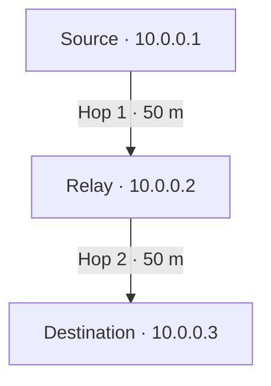

# Adaptive Routing in MANETs

COMP 5213 – Computer Networks · Group 8

**Status:** Three-node AODV baseline verified in ns-3.46 on Ubuntu.

## 1. Overview

Imagine three phones outdoors. The first can reach the middle phone by radio. The middle phone can reach the last. A **mobile ad hoc network (MANET)** lets devices forward messages for each other without a fixed access point. A **node** is one device, a **packet** is one small unit of data, and a **hop** is one transmission between neighboring devices.

**ns-3** is the program that models these devices, their radios, and the passage of time on one computer. **Ad hoc On-Demand Distance Vector (AODV)** is the routing protocol inside the model. When a sender needs a route, AODV can ask nearby nodes for a path. Each device records which neighbor should receive the packet next.

| Three-node UDP run | Sent | Received | Delivery |
|---|---:|---:|---:|
| Relay stays in place | 30 | 30 | 100% |
| Relay moves out of range at 10 s | 30 | 10 | 33.33% |

Both routing tables showed the same two-hop path at 8 seconds. The moving run demonstrates what happens when the only relay leaves. The research question comes next: when more than one path is available, can a mobility-aware routing decision improve delivery?

[Follow the setup, experiments, and results in the project log](docs/project-log.md)

## 2. Problem Statement

Standard routing protocols such as AODV discover routes when needed, but changing network conditions can cause established routes to fail.

Our project will investigate a route-selection mechanism that adjusts the importance of selected routing factors according to observed mobility conditions.

## 3. Objectives

- Establish a working MANET simulation using NS-3.
- Evaluate standard AODV as a baseline.
- Design and implement a lightweight adaptive route-selection mechanism.
- Investigate how mobility-dependent routing decisions affect network performance.
- Compare the proposed approach against the baseline under controlled simulation conditions.
- Analyze and document experimental results.

## 4. Proposed Approach

The initial design will investigate the use of factors such as link quality, link stability, and mobility.

The proposed workflow is:

1. Observe relevant network conditions.
2. Estimate the current mobility regime.
3. Adjust the importance of selected routing factors.
4. Evaluate candidate routing decisions using the resulting scores.
5. Measure performance under different mobility scenarios.

The precise scoring formula, mobility thresholds, and integration with AODV will be finalized during implementation and experimentation.

## 5. Experimental Evaluation

The baseline and proposed approach will be evaluated under comparable simulation conditions.

Planned metrics:

- Packet Delivery Ratio (PDR)
- Throughput
- End-to-End Delay
- Routing Overhead
- Route Breaks

The experiments will investigate whether the proposed mechanism improves performance and identify any trade-offs.

## 6. Technology Stack

- **Operating system:** Ubuntu running in a virtual machine
- **Network simulation:** NS-3
- **Implementation:** C++
- **Analysis and visualization:** Python, pandas, NumPy, and Matplotlib
- **Version control:** Git and GitHub

## 7. Research Foundation

The initial literature review is guided by the following journal papers:

1. *An Adaptive Reinforcement Learning-Based Mobility-Aware Routing for Heterogeneous Wireless Body Area Networks* (2024).
2. *Topology Control Using Optimized Clustering Scheme in Mobile Ad Hoc Network* (2024).
3. *An Adaptive Congestion and Energy Aware Multipath Routing Scheme for Mobile Ad-Hoc Networks Through Stable Link Prediction* (2023).

These papers provide background on mobility-aware routing, topology control, link stability, and adaptive routing decisions. They will inform our design without being reproduced as complete implementations.

## 8. Project Status

- [x] GitHub repository created.
- [x] Project topic approved.
- [x] Ubuntu development environment verified.
- [x] ns-3.46 built and tested.
- [x] Three-node AODV baseline verified with ping and UDP.
- [ ] Four-node baseline with an alternate relay (Step 3).
- [ ] Adaptive mechanism implemented.
- [ ] Experiments completed and results analyzed.

## 9. Repository

Source code, documentation, and reproducible experiment configurations will be maintained in this repository as development progresses.
