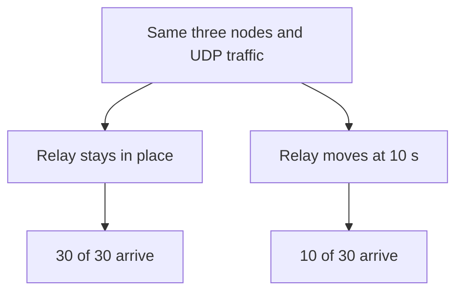

# Project log · From an empty simulator to a two-hop route

**COMP 5213 · Group 8 · November 10, 2026**

## 1. What are we building?

Imagine three people standing in a line, each with a short-range radio. The first wants to send a message to the last. The person in the middle can hear both and passes it along. If that person walks away, the first can keep speaking even though the last hears nothing.

| Project term | Meaning in this experiment |
|---|---|
| ns-3 | A network simulator. One Ubuntu computer calculates what happens to all three simulated radios. A time such as 8 s refers to the simulator’s clock. |
| Mobile ad hoc network (MANET) | A network where devices communicate directly and can move. “Ad hoc” means the devices can organize and forward traffic without a fixed access point. |
| Node and IP address | One simulated device and the address used to identify it. Node numbers start at 0. Here node 0 has address `10.0.0.1`. |
| Packet, relay, hop | A packet carries some data. A relay forwards it. One hop takes it from one device to its next neighbor. |
| Route and routing table | A route is the path to a destination. A device’s table tells it where to send the packet next. |
| AODV | Ad hoc On-Demand Distance Vector. A device discovers a route when it needs one. A route request can travel through neighbors and a reply establishes forwarding information. |
| Ping and UDP | Ping asks for an echo reply and tests a round trip. UDP (User Datagram Protocol) lets a sender send data without requiring a reply. We count arrivals at the destination. |
| Baseline and adaptive routing | A baseline gives us a reference measurement using standard AODV. The proposed adaptive method would change how routes are selected as conditions change. |

## 2. Set up the simulator

| Location under `~/Projects/` | Purpose |
|---|---|
| `ns-3.46/` | Simulator source, CMake configuration, and compiled programs |
| `Adaptive-Routing-in-MANETs/simulations/` | Project-owned simulation source on the experiment VM |
| `Adaptive-Routing-in-MANETs/results/` | One directory per experiment or case on the VM |

On Ubuntu, install the tools. Git retrieves source code, CMake describes what to build, and Ninja runs the compiler. Use the existing checkouts if already present.

```bash
sudo apt update
sudo apt install -y build-essential cmake ninja-build git python3
mkdir -p ~/Projects
cd ~/Projects
git clone https://github.com/Sumit-Bhosle/Adaptive-Routing-in-MANETs.git
git clone --depth 1 --branch ns-3.46 https://gitlab.com/nsnam/ns-3-dev.git ns-3.46
```

The release tag resolved to commit `ea50b72ab79b1ec5912c66d5b384effa829f18bc`. Git calls this checkout a “detached HEAD” because it points at the selected release. The VM used GNU C++ 15.2.0 and Python 3.14.4. The `./ns3` launcher stopped while parsing its arguments with `action 'store_true' is not valid for positional arguments`. Calling CMake directly built the same release successfully.

```bash
cd ~/Projects/ns-3.46
cmake -S . -B cmake-cache -G Ninja -DCMAKE_BUILD_TYPE=Debug \
  -DNS3_ENABLED_MODULES=core -DNS3_EXAMPLES=ON -DNS3_LOG=ON &&
cmake --build cmake-cache --target hello-simulator --parallel 2 &&
./build/examples/tutorial/ns3.46-hello-simulator-debug
```

**Observed:** `Hello Simulator`. This checks that the compiler, build system, and simulator can produce and run a program. The next check exercises the simulated network.

## 3. Follow a ping through three devices

The bundled AODV example placed the source, relay, and destination in a line, 50 m apart from each neighbor. A 30-second run moved the middle node away at one third of the duration, or 10 s. The program wrote its routing tables at 8 s, while the relay was still in place.

```bash
cd ~/Projects/ns-3.46
cmake -S . -B cmake-cache \
  '-DNS3_ENABLED_MODULES=aodv;wifi;internet-apps;point-to-point' &&
cmake --build cmake-cache --target aodv-example --parallel 2
```

The first build omitted `point-to-point` and failed on `ns3/point-to-point-module.h`. The bundled example includes that header. Enabling the module allowed the build to finish. The devices in this example communicate using ad hoc Wi-Fi.

```bash
project_dir="$HOME/Projects/Adaptive-Routing-in-MANETs"
mkdir -p "$project_dir/results/aodv-three-node"
cd "$project_dir/results/aodv-three-node"
set -o pipefail
~/Projects/ns-3.46/build/src/aodv/examples/ns3.46-aodv-example-debug \
  --size=3 --step=50 --time=30 --pcap=0 --printRoutes=1 | tee ping.log
cat aodv.routes
```

| Simulated time | Observation |
|---|---|
| 0–9 s | Ping replies for sequences 0 through 9 |
| 8 s | Source table showed destination `10.0.0.3` via gateway `10.0.0.2`, flag `UP`, 2 hops. The destination also had a reverse route via the relay. |
| 10 s | The simulator moved the relay out of range. |
| End of 30 s | 30 requests sent, 10 replies received. The remaining 20 requests produced no reply. |

## 4. Change one thing and count UDP arrivals

The project copied the bundled example into `simulations/aodv-udp-baseline.cc` on the VM. It kept the node positions and Wi-Fi settings. A UDP server listened on the destination at port 9000. A UDP client on the source sent one 128-byte packet per second starting at 0.5 s, with a maximum of 30 packets. The `moveRelay` option switched the movement event on or off.



**Build from the project source on the VM.** The symbolic link makes the source visible under the simulator’s scratch directory. Edits belong in the project copy. A fresh checkout containing only documentation also needs the UDP source from the experiment VM to run this stage.

```bash
project_dir="$HOME/Projects/Adaptive-Routing-in-MANETs"
ns3_dir="$HOME/Projects/ns-3.46"
ln -sfn "$project_dir/simulations/aodv-udp-baseline.cc" \
  "$ns3_dir/scratch/aodv-udp-baseline.cc"
cmake -S "$ns3_dir" -B "$ns3_dir/cmake-cache" &&
cmake --build "$ns3_dir/cmake-cache" --target scratch_aodv-udp-baseline --parallel 2
```

**Run both cases.** Each run writes `aodv.routes` to its working directory. Separate folders preserve both snapshots.

```bash
project_dir="$HOME/Projects/Adaptive-Routing-in-MANETs"
sim="$HOME/Projects/ns-3.46/build/scratch/ns3.46-aodv-udp-baseline-debug"
set -o pipefail
for scenario in stationary moving; do
  move=0
  if [ "$scenario" = moving ]; then move=1; fi
  out="$project_dir/results/udp-three-node/$scenario"
  mkdir -p "$out" || break
  (cd "$out" && "$sim" --size=3 --step=50 --time=30 --pcap=0 \
    --printRoutes=1 --moveRelay="$move" | tee run.log) || break
done
```

## 5. Read the evidence

At 8 s the source reported the following row in **both UDP runs**:

| Destination | Gateway | Interface | Flag | Expire | Hops |
|---|---|---|---|---|---:|
| 10.0.0.3 | 10.0.0.2 | 10.0.0.1 | UP | +2.5s | 2 |

Read it from the source’s perspective: “I am sending from my interface `10.0.0.1`. To reach `10.0.0.3`, send the packet first to `10.0.0.2`. The route is active and takes two hops.” The expiry field is the remaining lifetime recorded at the snapshot. Later traffic can refresh it.

| UDP run | Sent | Received | Lost | Packet delivery ratio |
|---|---:|---:|---:|---:|
| Stationary relay | 30 | 30 | 0 | 100% |
| Moving relay | 30 | 10 | 20 | 33.33% |

**Packet delivery ratio (PDR)** is the number received divided by the number sent, multiplied by 100. For the moving run, 10 ÷ 30 × 100 gives 33.33%. The sender counted bytes accepted by its socket and divided by the fixed 128-byte packet size. The receiver counted incoming packets separately. A successful send at the source does not guarantee arrival.

The ping log shows individual replies. The UDP summary reports totals. Ten UDP transmissions were scheduled before movement, and the moving run received ten packets overall. The UDP output did not record individual arrival times.

## 6. What question remains?

With one relay, the experiment can demonstrate a broken path. Comparing routing choices requires another usable path. The planned four-node experiment will add a second relay, identify the active route, move its relay, and measure whether and when delivery resumes. That experiment and the proposed adaptive routing method are still pending.

## 7. AODV recovers through a second relay

Can delivery resume when the active relay moves but a second path remains available?

In a four-node ns-3.46 simulation, the source sent 30 UDP packets to
10.0.0.4. Both runs used 10.0.0.2 as the next hop at 8 seconds.

| Run | Next hop at 8 s | Next hop at 12 s | Packets received |
|---|---|---|---:|
| Both relays stationary | 10.0.0.2 | 10.0.0.2 | 30/30 |
| Active relay moved at 10 s | 10.0.0.2 | 10.0.0.3 | 29/30 |

In the moving run, packet 10 was lost. Packet 11 arrived at 11.507394 s,
the first observed delivery after movement. The 12-second routing snapshot
confirmed an active two-hop route through the second relay.

Trial: `results/udp-four-node/trial-bphVhd/`
