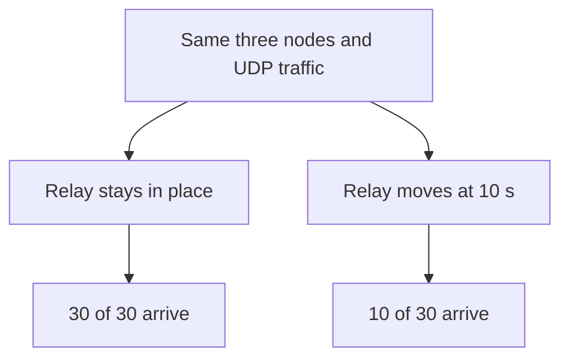
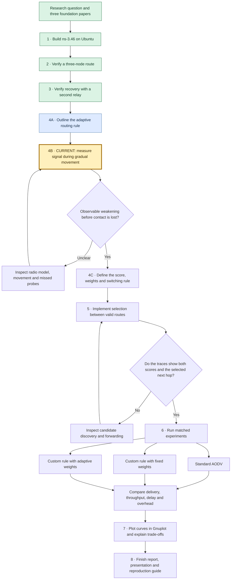
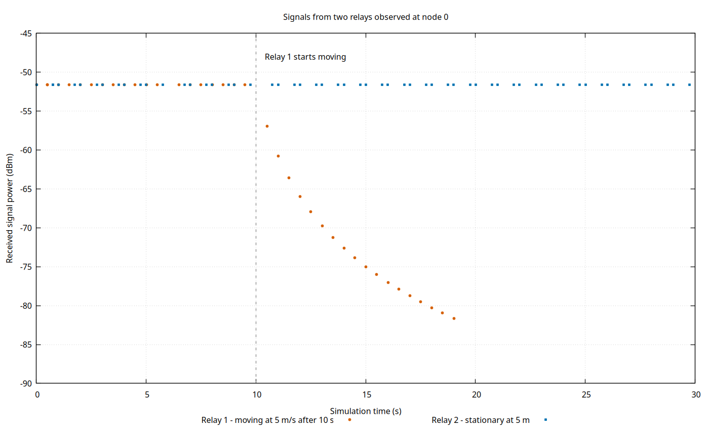
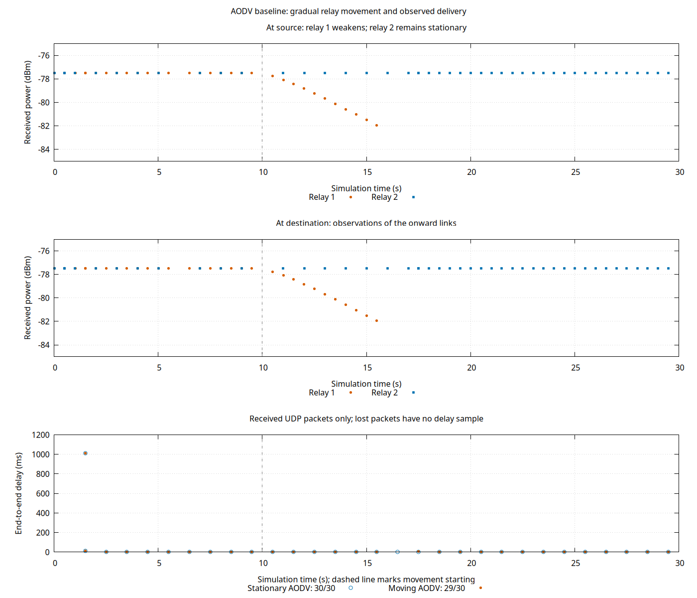

# Project log · From an empty simulator to a two-hop route

**COMP 5213 · Group 8 · November 10, 2026**

## 1. What are we building?

Imagine three people standing in a line, each with a short-range radio. The first wants to send a message to the last. The person in the middle can hear both and passes it along. If that person walks away, the first can keep speaking even though the last hears nothing.

| Project term | Meaning in this experiment |
|---|---|
| ns-3 | A network simulator. One Ubuntu computer calculates what happens to all three simulated radios. A time such as 8 s refers to the simulator’s clock. |
| Mobile ad hoc network (MANET) | A network where devices communicate directly and can move. “Ad hoc” means the devices can organize and forward traffic without a fixed access point. |
| Node and IP address | One simulated device and the address used to identify it. Node numbers start at 0. Here node 0 has address `10.0.0.1`. |
| Packet, relay, hop | A packet carries some data. A relay forwards it. One hop takes it from one device to its next neighbor. |
| Route and routing table | A route is the path to a destination. A device’s table tells it where to send the packet next. |
| AODV | Ad hoc On-Demand Distance Vector. A device discovers a route when it needs one. A route request can travel through neighbors and a reply establishes forwarding information. |
| Ping and UDP | Ping asks for an echo reply and tests a round trip. UDP (User Datagram Protocol) lets a sender send data without requiring a reply. We count arrivals at the destination. |
| Baseline and adaptive routing | A baseline gives us a reference measurement using standard AODV. The proposed adaptive method would change how routes are selected as conditions change. |

## 2. Set up the simulator

| Location under `~/Projects/` | Purpose |
|---|---|
| `ns-3.46/` | Simulator source, CMake configuration, and compiled programs |
| `Adaptive-Routing-in-MANETs/simulations/` | Project-owned simulation source on the experiment VM |
| `Adaptive-Routing-in-MANETs/results/` | One directory per experiment or case on the VM |

On Ubuntu, install the tools. Git retrieves source code, CMake describes what to build, and Ninja runs the compiler. Use the existing checkouts if already present.

```bash
sudo apt update
sudo apt install -y build-essential cmake ninja-build git python3
mkdir -p ~/Projects
cd ~/Projects
git clone https://github.com/Sumit-Bhosle/Adaptive-Routing-in-MANETs.git
git clone --depth 1 --branch ns-3.46 https://gitlab.com/nsnam/ns-3-dev.git ns-3.46
```

The release tag resolved to commit `ea50b72ab79b1ec5912c66d5b384effa829f18bc`. Git calls this checkout a “detached HEAD” because it points at the selected release. The VM used GNU C++ 15.2.0 and Python 3.14.4. The `./ns3` launcher stopped while parsing its arguments with `action 'store_true' is not valid for positional arguments`. Calling CMake directly built the same release successfully.

```bash
cd ~/Projects/ns-3.46
cmake -S . -B cmake-cache -G Ninja -DCMAKE_BUILD_TYPE=Debug \
  -DNS3_ENABLED_MODULES=core -DNS3_EXAMPLES=ON -DNS3_LOG=ON &&
cmake --build cmake-cache --target hello-simulator --parallel 2 &&
./build/examples/tutorial/ns3.46-hello-simulator-debug
```

**Observed:** `Hello Simulator`. This checks that the compiler, build system, and simulator can produce and run a program. The next check exercises the simulated network.

## 3. Follow a ping through three devices

The bundled AODV example placed the source, relay, and destination in a line, 50 m apart from each neighbor. A 30-second run moved the middle node away at one third of the duration, or 10 s. The program wrote its routing tables at 8 s, while the relay was still in place.

```bash
cd ~/Projects/ns-3.46
cmake -S . -B cmake-cache \
  '-DNS3_ENABLED_MODULES=aodv;wifi;internet-apps;point-to-point' &&
cmake --build cmake-cache --target aodv-example --parallel 2
```

The first build omitted `point-to-point` and failed on `ns3/point-to-point-module.h`. The bundled example includes that header. Enabling the module allowed the build to finish. The devices in this example communicate using ad hoc Wi-Fi.

```bash
project_dir="$HOME/Projects/Adaptive-Routing-in-MANETs"
mkdir -p "$project_dir/results/aodv-three-node"
cd "$project_dir/results/aodv-three-node"
set -o pipefail
~/Projects/ns-3.46/build/src/aodv/examples/ns3.46-aodv-example-debug \
  --size=3 --step=50 --time=30 --pcap=0 --printRoutes=1 | tee ping.log
cat aodv.routes
```

| Simulated time | Observation |
|---|---|
| 0–9 s | Ping replies for sequences 0 through 9 |
| 8 s | Source table showed destination `10.0.0.3` via gateway `10.0.0.2`, flag `UP`, 2 hops. The destination also had a reverse route via the relay. |
| 10 s | The simulator moved the relay out of range. |
| End of 30 s | 30 requests sent, 10 replies received. The remaining 20 requests produced no reply. |

## 4. Change one thing and count UDP arrivals

The project copied the bundled example into `simulations/aodv-udp-baseline.cc` on the VM. It kept the node positions and Wi-Fi settings. A UDP server listened on the destination at port 9000. A UDP client on the source sent one 128-byte packet per second starting at 0.5 s, with a maximum of 30 packets. The `moveRelay` option switched the movement event on or off.



**Build from the project source on the VM.** The symbolic link makes the source visible under the simulator’s scratch directory. Edits belong in the project copy. A fresh checkout containing only documentation also needs the UDP source from the experiment VM to run this stage.

```bash
project_dir="$HOME/Projects/Adaptive-Routing-in-MANETs"
ns3_dir="$HOME/Projects/ns-3.46"
ln -sfn "$project_dir/simulations/aodv-udp-baseline.cc" \
  "$ns3_dir/scratch/aodv-udp-baseline.cc"
cmake -S "$ns3_dir" -B "$ns3_dir/cmake-cache" &&
cmake --build "$ns3_dir/cmake-cache" --target scratch_aodv-udp-baseline --parallel 2
```

**Run both cases.** Each run writes `aodv.routes` to its working directory. Separate folders preserve both snapshots.

```bash
project_dir="$HOME/Projects/Adaptive-Routing-in-MANETs"
sim="$HOME/Projects/ns-3.46/build/scratch/ns3.46-aodv-udp-baseline-debug"
set -o pipefail
for scenario in stationary moving; do
  move=0
  if [ "$scenario" = moving ]; then move=1; fi
  out="$project_dir/results/udp-three-node/$scenario"
  mkdir -p "$out" || break
  (cd "$out" && "$sim" --size=3 --step=50 --time=30 --pcap=0 \
    --printRoutes=1 --moveRelay="$move" | tee run.log) || break
done
```

## 5. Read the evidence

At 8 s the source reported the following row in **both UDP runs**:

| Destination | Gateway | Interface | Flag | Expire | Hops |
|---|---|---|---|---|---:|
| 10.0.0.3 | 10.0.0.2 | 10.0.0.1 | UP | +2.5s | 2 |

Read it from the source’s perspective: “I am sending from my interface `10.0.0.1`. To reach `10.0.0.3`, send the packet first to `10.0.0.2`. The route is active and takes two hops.” The expiry field is the remaining lifetime recorded at the snapshot. Later traffic can refresh it.

| UDP run | Sent | Received | Lost | Packet delivery ratio |
|---|---:|---:|---:|---:|
| Stationary relay | 30 | 30 | 0 | 100% |
| Moving relay | 30 | 10 | 20 | 33.33% |

**Packet delivery ratio (PDR)** is the number received divided by the number sent, multiplied by 100. For the moving run, 10 ÷ 30 × 100 gives 33.33%. The sender counted bytes accepted by its socket and divided by the fixed 128-byte packet size. The receiver counted incoming packets separately. A successful send at the source does not guarantee arrival.

The ping log shows individual replies. The UDP summary reports totals. Ten UDP transmissions were scheduled before movement, and the moving run received ten packets overall. The UDP output did not record individual arrival times.

## 6. What question remains?

With one relay, the experiment can demonstrate a broken path. Comparing routing choices requires another usable path. The planned four-node experiment will add a second relay, identify the active route, move its relay, and measure whether and when delivery resumes. That experiment and the proposed adaptive routing method are still pending.

## 7. AODV recovers through a second relay

Can delivery resume when the active relay moves but a second path remains available?

In a four-node ns-3.46 simulation, the source sent 30 UDP packets to
10.0.0.4. Both runs used 10.0.0.2 as the next hop at 8 seconds.

| Run | Next hop at 8 s | Next hop at 12 s | Packets received |
|---|---|---|---:|
| Both relays stationary | 10.0.0.2 | 10.0.0.2 | 30/30 |
| Active relay moved at 10 s | 10.0.0.2 | 10.0.0.3 | 29/30 |

In the moving run, packet 10 was lost. Packet 11 arrived at 11.507394 s,
the first observed delivery after movement. The 12-second routing snapshot
confirmed an active two-hop route through the second relay.

Trial: `results/udp-four-node/trial-bphVhd/`

## 8. Project roadmap and current checkpoint

Green marks verified work, blue marks the proposed design, and amber marks the current checkpoint. The final comparison uses the same radio model, movement traces, traffic and measurement window for all three methods.



**Next experiment (Step 4B).** Move one relay gradually and keep a second relay stationary. Record the time, relay identity, sequence number and received signal strength of probes. Plot received power (dBm) against simulated time (s) in Gnuplot. Check whether weakening is observable before reception stops. Use that evidence to set the adaptive rule’s thresholds.

## Two Relay Signal Comparison at the Sender

### Purpose and setup

Observe both relay candidates from the device that will eventually
make the adaptive routing decision.

The experiment uses ns-3.46, standard AODV, 802.11a Wi-Fi at 6 Mb/s,
LogDistancePropagationLossModel, and ConstantVelocityMobilityModel.

| Setting | Value |
|---|---|
| Observer | Node 0 at (0, 0, 0) |
| Relay 1 initial position | (5, 0, 0) |
| Relay 2 initial position | (0, 5, 0) |
| Node 3 | Retained at (100, 0, 0), with no application traffic |
| Simulation duration | 30 s |
| Probe size | 128 bytes, configured in UdpClient |
| Probe interval | 1 s per relay |
| Probe count | 30 per relay |
| Application start times | Relay 1 at 0.5 s; relay 2 at 0.75 s |
| Receiver ports | 9001 and 9002 on node 0 |
| Movement | Relay 1 starts at 10 s, moving along positive x at 5 m/s |
| Random seed and run | Seed 12345, run 1 |

MonitorSnifferRx is attached to node 0. Transmitter MAC-address filters
separate observations from relay 1 and relay 2.

### Stationary control

Both relays remained 5 m from node 0. Each delivered 30/30 UDP probes.
Recorded signal power from both relays remained at -51.626200 dBm.

### Moving trial

Relay 1 delivered 19/30 probes (63.33%), while relay 2 delivered
30/30 (100%).

Position snapshots verified relay 1 at 5 m at 8 s, 15 m at 12 s,
and 55 m at 20 s. Relay 2 remained 5 m from node 0.

Relay 1's final recorded Wi-Fi frame arrived at 19.018170 s with
signal power -81.649675 dBm. Relay 2's final recorded frame arrived
at 29.750314 s with signal power -51.626200 dBm.



### Files and reproduction

- `simulations/relay-probe-comparison.cc` implements the experiment.
- `plots/relay-probe-comparison.gp` generates the comparison figure.
- `results/relay-probe-comparison/verified-stationary/` stores the control.
- `results/relay-probe-comparison/verified-moving/` stores the moving trial,
  routing snapshots, extracted measurements, and figure.

Use `--moveRelay=0` for the stationary control and `--moveRelay=1`
for the moving trial. Run each in its own output directory.

### Interpretation and limitations

Node 0 observed weakening from one relay while the other remained steady.
This establishes the first two-candidate signal comparison.

The signal trace includes successfully received Wi-Fi data frames,
including frames carrying routing messages. MAC sequence gaps cannot
be interpreted directly as missing UDP probes. UDP delivery totals
alone also cannot establish whether delivery was direct or forwarded.

Both experiments use one fixed seed and run. Repeated-run evaluation
remains pending. Relay 2 becomes both stronger and steadier in this
scenario, so the outcome alone cannot demonstrate a benefit from
adaptive weighting.

### Next work

Define quality, stability, freshness, and switching rules. First log
their decisions, then verify their integration with actual forwarding.
Add identifiable direct-probe measurements before calculating link
delivery ratios. Test a strong but weakening link against a weaker,
steady link, and check valid onward routes before selecting a relay.

## Milestone: signal-based candidate scoring

### Purpose

Investigate whether signal weakening can inform relay preferences before
the moving relay becomes weaker than a stationary alternative.

### Experiment

- Simulator: ns-3.46; existing AODV routing.
- Duration: 30 seconds; seed 12345, run 1.
- Observer: node 0.
- Relay 1: initially 5 m away; moves along positive x at 5 m/s from 10 s.
- Relay 2: stationary, 25 m from the observer.
- Each relay sends 30 UDP probes to the observer.
- Signal observations include received Wi-Fi data frames, which can
  carry application traffic or routing messages.
- This experiment does not carry application traffic to node 3.

### Scoring procedure

`scripts/score-candidates.py` replays observations once per second,
using only information available at each decision time.

Signal quality is normalized between -85 and -50 dBm and clipped to
[0, 1]. These are pilot normalization bounds, not validated reception
thresholds.

A straight-line fit over the preceding three seconds estimates signal
weakening. Stability is one minus the weakening rate divided by 5 dB/s,
clipped to [0, 1]. Candidates require at least three recent samples
spanning one second; observations older than two seconds are excluded.

The fixed rule gives quality and stability equal weight. The adaptive
rule increases stability weight from 0.2 to at most 0.8 according to
the largest weakening rate among eligible candidates. Both candidates
receive the same weights. Exact score ties prefer the lower relay ID.
All three rules use the same eligibility checks.

These settings are provisional and require sensitivity evaluation.

### Observed results

| Scenario | Relay 1 probes received | Relay 2 probes received |
|---|---:|---:|
| Both stationary | 30/30 | 30/30 |
| Relay 1 moving | 19/30 | 30/30 |

At 1 s, neither candidate had sufficient history. At 2 s, all rules
preferred relay 1. In the moving run, fixed and adaptive scoring
preferred relay 2 at 12 s; strongest-signal selection followed at 15 s.
The stationary control retained relay 1.

At 12 s, relay 1's latest measured signal was -63.56 dBm, versus
-72.60 dBm for relay 2. Relay 1's estimated weakening rate was
5.277 dB/s. Adaptive stability weight reached 0.8, producing scores
of approximately 0.122 for relay 1 and 0.871 for relay 2.

The stability weight later decreased as the measured signal decline
slowed. It represents recent signal weakening, not measured node speed
or a prediction of remaining link lifetime.

### Visualization and reproducibility

`plots/candidate-decisions.gp` plots the three selection rules.
`candidate-scores.csv` contains two rows per decision time.
`candidate-decisions.csv` retains one row per time because the overall
choices are repeated in both candidate rows.

Filtering alternate rows with undefined values originally broke the
plotted lines. Creating the single-row-per-time input resolved this.

Preserved trial directories:

- `results/relay-probe-comparison/stationary-25m-cGuNzk/`
- `results/relay-probe-comparison/moving-relay1-25m-pybHRK/`

To regenerate scores, run:

```bash
python3 scripts/score-candidates.py results/relay-probe-comparison/moving-relay1-25m-pybHRK/run.log
python3 scripts/score-candidates.py results/relay-probe-comparison/stationary-25m-cGuNzk/run.log

(
  cd results/relay-probe-comparison/moving-relay1-25m-pybHRK &&
  awk -F, 'NR == 1 || $2 == 1' candidate-scores.csv > candidate-decisions.csv &&
  gnuplot ../../../plots/candidate-decisions.gp
)
```

### Interpretation and next phase

Both scoring methods preferred relay 2 three seconds before the
strongest-signal rule. Their identical choices do not demonstrate
an advantage of adaptive weighting over fixed weighting.

Scoring was performed offline and did not control forwarding.
Probe delivery totals describe the underlying AODV experiment.

Next: validate onward paths through both relays, integrate live scoring
with actual forwarding, verify packet paths, and compare performance
under matched network settings.

## Milestone: complete-path validation and gradual-movement baseline

### Purpose and settings

Validate both complete relay paths before integrating custom selection.
Source: (0, 0); relay 1: (35, 10); relay 2: (35, -10);
destination: (70, 0), in metres.

The experiments use ns-3.46, standard AODV, ad hoc 802.11a Wi-Fi,
6 Mbps data/control modes, and log-distance propagation with exponent 3,
reference distance 1 m, and reference loss 46.6777 dB.
Each run lasts 30 s with seed 12345 and run 1.
The source sends 30 UDP packets of 128 bytes, one per second from 0.5 s.

### Complete-path validation

Each relay alone delivered 30/30 packets through a two-hop route.
Both available delivered 30/30 via relay 1.
With both relays placed far away, delivery was 0/30 and no usable
destination route was found. IN_SEARCH entries are not valid paths.

Results: `results/relay-path-validation/trial-odbO5P/`.

### Gradual movement

Relay 1 moves along positive y at 5 m/s from 10 s.
Relay 2 and both endpoints remain stationary.

| Measurement | Stationary | Moving |
|---|---:|---:|
| Received packets | 30/30 | 29/30 |
| Delivery ratio | 100% | 96.67% |
| Missing sequence | None | 16 |
| Packet 17 delay | 0.688 ms | 9.679 ms |
| Largest arrival gap | 1.000000 s | 2.008991 s |

Moving-run route snapshots show relay 1 UP at 16 s, its route DOWN
at 17 s, and relay 2 UP at 18 s. Snapshots do not establish exact
failure, route-installation or repair times.

Results: `results/relay-mobility-baseline/trial-IeNySU/`.

### Passive live observations

`simulations/relay-live-observation.cc` adds MonitorSnifferRx callbacks
at source and destination. It does not add traffic or change routing.

Relay 1 starts near -77.490 dBm at both endpoints. Its last recorded
frame at each endpoint is at 15.500688 s, near -81.960 dBm.
Relay 2 remains near -77.490 dBm through its last observation at
29.500688 s. Delivery remains 29/30.

These observations include successfully received Wi-Fi data frames,
not exclusively UDP application packets. Frame counts are not probe
delivery ratios; missing observations do not independently prove link
failure. The final observed signal is not a calibrated failure threshold.

Destination-side measurements are diagnostic information. The source
cannot use them unless an explicit information exchange is implemented.

### Figure and reproduction



The top panels use the passive-observation run. The delay panel uses
the original stationary and moving baseline logs.
Lost packets have no delay samples.

From `results/relay-live-observation/moving-ICAaHb/`, run:
`gnuplot ../../../plots/relay-live-observation.gp`

The plotting inputs are stored alongside the figure.

### Next phase and limits

Implement live scoring in observation-only mode, then integrate actual
forwarding with valid onward paths and controlled switching.
The symmetric starting topology is an integration test; it does not
by itself establish an adaptive advantage over strongest-signal selection.
These are individual controlled runs, not repeated statistical evaluation.

### Startup delay and transition detail

Both stationary and moving baseline runs recorded the same initial
arrivals: packet 0 arrived at 1.509916 s with 1009.916452 ms delay,
and packet 1 arrived at 1.510701 s with 10.700694 ms delay.
Subsequent early packets had approximately 0.688 ms delay.

This startup effect occurs before movement begins at 10 s. It is
consistent with initial route discovery and buffering, but arrival
logs alone do not identify its exact cause.

The Gnuplot figure preserves the full delay range and adds a zoom
covering 14–20 s and 0–15 ms. In the moving run, packet 16 was not
received; packet 17 arrived at 17.509679 s with 9.679 ms delay.
Lost packets have no delay sample and are not plotted as zero delay.

The 2.008991 s gap between arrivals of packets 15 and 17 is an
observed delivery gap, not an exact measurement of route repair time.

## Milestone: live candidate scoring and replay verification

### Purpose

Move the existing offline scoring calculation into ns-3 and verify
equivalent results while the simulation is running.

### Implementation

Simulation: `simulations/relay-live-scoring.cc`.

Only signals received at node 0 feed the scorer. Destination observations
remain diagnostic and are not supplied to the source's selection logic.

Scoring runs once per second from 1 through 30 s. It preserves the Python
implementation's three-second observation window, two-second freshness
limit, minimum three samples spanning one second, quality normalization,
weakening calculation, adaptive weights and lower-ID exact tie rule.

The scorer records preferences without modifying routes or adding traffic.
Standard AODV remains responsible for packet forwarding.

### Verification

Trial directory: `results/relay-live-scoring/trial-cnTRwL/`.

The simulation writes `live-candidate-scores.csv`. Source observations
are emitted as precise `SIGNAL_RX` records. The existing Python scorer
replays those inputs to produce `candidate-scores.csv`.

Both scenarios passed comparison of all 60 candidate rows each:
120 rows total. Status, sample counts and choices matched exactly.
Numerical fields matched with relative tolerance 1e-9 and absolute
tolerance 1e-10.

### Results

| Scenario | Preferences | UDP delivery |
|---|---|---|
| Stationary | None at 1 s; relay 1 from 2 s | 30/30 |
| Moving | None at 1 s; relay 1 from 2 s; relay 2 from 14 s | 29/30 |

All three rules produced the same choices in this experiment.
Delivery counts remained consistent with the previous AODV baseline.

| Snapshot time | AODV source route to destination |
|---|---|
| 14–16 s | Relay 1 |
| 17 s | No UP destination route |
| 18–19 s | Relay 2 |

### Visualization and reproducibility

`plots/relay-live-decisions.gp` displays strongest-signal, fixed-weight
and adaptive preferences in separate panels. The fourth panel shows
AODV routing snapshots as points, without implying exact transition
times between observations.

Plot inputs and the PNG are stored in:
`results/relay-live-scoring/trial-cnTRwL/move-1/`.

From that directory, regenerate the plot with:

    gnuplot ../../../../plots/relay-live-decisions.gp

### Interpretation

The earlier preference for relay 2 motivates a forwarding experiment.
It does not establish an exact four-second recovery improvement,
prove delivery gains, or demonstrate an advantage over fixed weights.
Candidate preferences are not actual forwarding changes.

### Next phase

Implement controlled forwarding integration, verify the actual packet
path, and evaluate switching safeguards before broader comparisons.

## Milestone: forwarding rules under identical prototype support

The forwarding prototype was extended to compare strongest-signal,
fixed-weight and adaptive selection using the same configured onward
routes, eligibility checks, traffic and network settings.

Trial: `results/relay-selection-comparison/trial-G8jGsJ/`.

| Rule | Stationary delivery | Moving delivery | Moving-run relay switch |
|---|---|---|---|
| Strongest signal | 30/30 | 30/30 | Relay 1 to relay 2 at 14 s |
| Fixed weights | 30/30 | 30/30 | Relay 1 to relay 2 at 14 s |
| Adaptive weights | 30/30 | 30/30 | Relay 1 to relay 2 at 14 s |

All rules first installed relay 1 at 2 s. These results verify that
each rule can control forwarding. They do not demonstrate an advantage
from adaptive weighting in this scenario.

The next experiment varies the stationary relay's offset and the moving
relay's speed while retaining the scoring formulas. Configured onward
routes remain a prototype assumption; signal eligibility at the source
does not establish onward-link validity.

## Milestone: forwarding integration and probe-based selection

### Forwarding verification

Simulation: `simulations/relay-forwarding-prototype.cc`.
Trial: `results/relay-forwarding-prototype/trial-qoaktp/`.

The selector installs a source host route through its preferred relay.
Relay-to-destination host routes are configured in advance. When no
candidate is eligible, the source's selector route is removed, allowing
AODV to handle traffic.

UDP forwarding traces identified the relay carrying each packet.
Destination receive logs confirmed delivery.

Both stationary modes delivered 30/30 packets. Under movement,
standard AODV delivered 29/30 and the adaptive prototype delivered 30/30.
Packet 16 was absent from the AODV receive log but present in the
prototype's log. Packet 17 delay was 9.678968 ms under AODV and
0.688242 ms under the prototype.

Configured onward routes differ from standard AODV's routing support,
so these results do not isolate the contribution of adaptive weighting.

### Equal-support comparisons

Trials:
- `results/relay-selection-comparison/trial-G8jGsJ/`
- `results/relay-selection-scenarios/offset25-speed5-nMRwJB/`

Strongest-signal, fixed-weight and adaptive rules all delivered 30/30
packets in stationary and moving runs. All switched to relay 2 at 14 s
in the moving runs.

In the offset-25 adaptive run, relay 2 had only two samples in the
three-second window at 11–13 s. It was therefore ineligible, even though
this did not establish that the relay was disconnected.

### Regular neighbour probes

Simulation: `simulations/relay-probe-selection.cc`.
Initial check: `results/relay-probe-selection/check-VzMJTi/`.
Comparison: `results/relay-probe-selection/comparison-J425UC/`.

Each relay attempts 60 one-hop broadcast probes at 0.5-second intervals.
UDP payload size is 64 bytes, including the sequence/timestamp header.
The relays use staggered transmission schedules.

Only identified probe frames received at node 0 enter scoring.
The scoring formulas and eligibility requirements remain unchanged.

In the stationary check, both relays had 60/60 probes received.
In each moving comparison run, relay 1 had 31/60 probes received and
relay 2 had 60/60. All 60 sends per relay were accepted by their sockets;
socket acceptance does not establish over-the-air delivery.

### Results with probes

| Rule | Moving-run switch | Application packets received |
|---|---|---|
| Strongest signal | 14 s | 30/30 |
| Fixed weights | 12 s | 30/30 |
| Adaptive weights | 12 s | 30/30 |

All 180 candidate rows matched between live C++ scoring and Python replay.
Categorical fields and choices matched exactly. Numerical comparison
used relative tolerance 1e-9 and absolute tolerance 1e-10.

Each run attempted 120 probes, representing 7680 bytes of UDP payload.
This excludes UDP/IP/Wi-Fi headers and other network control traffic;
it is not a complete routing-overhead measurement.

### Interpretation and next work

Regular probes addressed inconsistent observation opportunities.
Stability-aware rules selected the alternative two seconds earlier than
strongest-signal selection, but all three achieved identical delivery.

No adaptive-weighting advantage over fixed weights is established.
Next, establish how onward-link validity is obtained and communicated,
then evaluate performance and overhead across planned, repeated trials.

## STA-RS comparison: achievements, evidence and limitations

### Method name

The working method name is **STA-RS — Signal-Trend-Aware Relay Selection**.
Historical filenames containing `adaptive` are retained for reproducibility.

STA-RS uses received signal quality and weakening trends to score relays.
Its feedback-enabled version additionally requires fresh onward-probe
evidence received through actual network messages.

The implementation remains a controlled four-node prototype. Onward host
routes are configured, while AODV remains available as fallback.

### Initial forwarding comparison

Trial: `results/relay-forwarding-prototype/trial-qoaktp/`.

| Measurement | Standard AODV | STA-RS forwarding prototype |
|---|---|---|
| Stationary application delivery | 30/30 | 30/30 |
| Moving application delivery | 29/30 | 30/30 |
| Moving delivery ratio | 96.666667% | 100% |
| Packet 16 | Not received | Received |
| Packet 17 end-to-end delay | 9.678968 ms | 0.688242 ms |

STA-RS selected relay 2 at 14 s. Forwarding traces showed relay 2 carrying
packet 14 and subsequent packets. Standard AODV used relay 2 for packet 17
after the interruption.

The delivery difference is one packet, or approximately 3.33 percentage
points, in this run. Packet 17 is a specific transition observation,
not the mean delay of the experiment.

These measurements predate regular neighbour probes and onward-feedback
integration. Configured onward routes are a comparison limitation.

### Equal-support selection comparison with periodic probes

Trial: `results/relay-probe-selection/comparison-J425UC/`.

| Rule | Relay 1 to relay 2 switch | Application delivery |
|---|---|---|
| Strongest signal | 14 s | 30/30 |
| Fixed weights | 12 s | 30/30 |
| STA-RS adaptive weights | 12 s | 30/30 |

All three rules used the same probing configuration and forwarding support.
Live scores matched Python replay across all 180 candidate rows.

The experiment demonstrates earlier selection by the stability-aware rules.
It does not demonstrate better delivery from earlier switching or an
advantage of adaptive weights over fixed weights.

### Onward-feedback verification

Trial: `results/relay-feedback-selection/trial-0eR1Mg/`.

The message sequence is: relay probe, destination confirmation, relay report
to source. The source updates its evidence only upon receiving the report.
Evidence age uses the original probe timestamp.

| Check | Stationary | Moving relay 1 |
|---|---|---|
| Application delivery | 30/30 | 30/30 |
| Source reports received for relay 1 | 60 | 31 |
| Source reports received for relay 2 | 60 | 60 |
| Relay 1 selection change | No change after initial selection | Relay 2 selected at 12 s |

In the moving run, relay 1 evidence was 1.75 s old at 17 s and 2.75 s
old at 18 s. With a two-second limit and once-per-second evaluation,
the 18 s check marked it expired.

This verifies message delivery and evidence expiry. It does not isolate
the benefit of onward verification because relay 1 lost connectivity to
both endpoints and STA-RS had already selected relay 2.

### Monitoring cost

The moving feedback run attempted 120 probes, 91 destination confirmations
and 91 relay reports: 302 messages, each with 64 bytes of UDP payload.

That totals 19328 bytes of attempted monitoring payload. It excludes
UDP/IP/Wi-Fi headers, other control traffic and application traffic.
Socket acceptance is not proof of over-the-air transmission or reception.

### Supported conclusion

STA-RS has progressed from offline scoring to verified live scoring,
actual forwarding control and network-delivered onward evidence.
The initial forwarding experiment showed improved delivery and a lower
delay for packet 17 compared with standard AODV in that specific setup.

General performance gains, the value of adaptive weighting, and the
benefit-versus-overhead trade-off remain to be established through
controlled ablations and repeated experiments.

## Experiment: contribution of onward-link verification

### Purpose and configuration

Test whether a strong source-facing link is sufficient to choose a relay
when its onward connection to the destination fails.

The experiment uses simulations/relay-onward-ablation.cc. Relay 1 moves
toward the source at 5 m/s for 6 s, starting at simulation time 10 s.
Relay 2 remains stationary. The simulation lasts 30 s and sends
30 application packets. Seed 12345 and run 1 are used.

The adaptive selector and configured onward routes are used in both
configurations. Probes and feedback remain enabled in both; requireOnward
controls whether fresh onward evidence is required for candidate eligibility.
The evidence freshness limit is 2 s.

### Results

| Movement | Onward confirmation required | Received | Delivery ratio |
|---|---|---:|---:|
| Stationary | No | 30/30 | 100% |
| Stationary | Yes | 30/30 | 100% |
| Toward source | No | 13/30 | 43.33% |
| Toward source | Yes | 28/30 | 93.33% |

During movement, the source received all 60 probes from each relay.
However, the destination received only 26 probes from relay 1, with
the last reception at 12.750230 s. Relay 2 delivered all 60 probes
to the destination.

Without the eligibility check, relay 1 remained selected and application
sequences 13 through 29 were missing. With the check enabled, relay 1's
evidence age reached 2.25 s at decision time 15 s. The selector changed
to relay 2, and delivery resumed with sequence 15 at 15.500688 s.
Only sequences 13 and 14 were missing.

The check therefore delivered 15 additional packets and increased
delivery by 50 percentage points in this experiment. The observed
3 s gap between arrivals of sequences 12 and 15 is a delivery gap,
not an exact measurement of route repair time.

### Interpretation and limitations

The result supports verifying onward connectivity rather than relying
only on source-facing signal measurements. It isolates the contribution
of the freshness gate, not adaptive weighting.

This is a single-run prototype ablation using configured onward routes.
A failed configured route can continue dropping packets when the check
is disabled. The result must not be presented as a 50-percentage-point
improvement over standard AODV.

The check governs custom relay selection; AODV fallback remains possible.
Feedback provides recent connectivity evidence, not a guarantee of
future delivery. Monitoring overhead and broader performance still
require measurement.

### Artifacts and plot labels

Trial: results/relay-onward-ablation/trial-P2th4c/
Plot script: plots/sta-rs-onward-ablation.gp
Figure: comparison/sta-rs-onward-ablation.png within the trial.

The figure shows packet reception by sequence number, cumulative
received packets versus simulation time, and evidence age versus
simulation time. Time and age are measured in seconds; packet totals
are counts; sequence numbers and reception states are unitless.

Final figures must include descriptive axis labels, units where
applicable, readable legends, scenario settings, and clearly labelled
event markers. Repeated-run figures should state the number of runs
and define any uncertainty intervals.

## Milestone: repeated evaluation of STA-RS failure feedback

### Problem and development sequence

Earlier observations showed that an improving source-to-relay link does
not guarantee a usable relay-to-destination link. Onward confirmation
therefore became a separate eligibility condition.

Broadcast-based monitoring also exposed stationary runs with no
application delivery. Diagnostics identified repeated, nearly simultaneous
ARP transmission failures from both relays at the destination. Broadcast
probe reception alone did not establish usable unicast delivery.

The subsequent version added staggered unicast validation to the
destination, with broadcast confirmations returned through the relay.
The previously failing stationary runs succeeded under this revised
monitoring setup. This change can also help AODV establish or maintain
routes, so it must not be credited solely to adaptive selection.

A separate packet-copy issue was corrected earlier: confirmation and
report packets use fresh packet objects while preserving the original
probe sequence and timestamp. Reusing packet UIDs had interfered with
AODV duplicate detection.

### Previous repeated checkpoint

The unicast-validation batch contains 120 simulations:
three scenarios, four methods, and ten runs per combination.

Results:
- Stationary: all methods delivered 300/300 packets.
- Moving away: monitored AODV delivered 293/300; all custom selectors
  delivered 300/300.
- Moving toward source: monitored AODV delivered 300/300; each custom
  selector delivered 280/300.

Batch: `results/relay-unicast-validation/repeated-JiCf7R/`.

In the toward-source case, STA-RS continued using relay 1 while its last
successful onward evidence remained within the two-second freshness
limit. In run 1, packets 13 and 14 were lost before selection changed
at 15 seconds.

### Failure-feedback implementation

Source: `simulations/relay-failure-feedback.cc`.

The original unicast-validation source is preserved separately.

- Each relay observes `MacTxFinalDataFailed`, filtered by the
  destination MAC address.
- The event indicates exhausted transmission attempts, not proof of a
  permanent disconnection.
- With `fastFailure=1`, the relay broadcasts a 64-byte UDP failure
  report with TTL 1.
- Reports are rate-limited to at most one per relay per 0.5 seconds.
- Source failure knowledge changes only when a report arrives through
  a simulated socket.
- A received failure report triggers an additional candidate evaluation.
- A relay is blocked while its latest confirmed original probe timestamp
  is no newer than the reported failure time.
- A newer successful validation can restore eligibility at a subsequent
  evaluation.
- The original freshness timeout remains active if reports are lost.
- Failure handling is shared by strongest, fixed, and adaptive selectors.
- The adaptive scoring formula is unchanged.

The source uses packet timestamps under the simulation's common clock.
Distributed clock synchronization and generalized route discovery are
outside the current prototype.

If no candidate is selected, the source removes its custom host route
and falls back to AODV. That fallback is not itself constrained by the
custom onward-evidence gate.

Failure-triggered evaluations add rows at non-integer times to the scoring
CSV. Scripts must not assume exactly 60 rows or only integer timestamps.
The earlier Python scorer does not reproduce the new failure-feedback
state machine.

### Smoke-test evidence

Batch: `results/relay-failure-feedback/check-7sWChV/`.

In toward-source run 1:
- Original STA-RS switched at 15.000000 s and delivered 28/30.
- Revised STA-RS switched at 13.316996 s and delivered 30/30.
- The selection change occurred 1.683004 s earlier.
- Monitored AODV also delivered 30/30.
- Revised STA-RS sent 23 failure reports, all received at the source.
- Their UDP payload total was 1472 bytes, excluding protocol headers,
  MAC retries, and other monitoring traffic.
- Monitored AODV sent one failure report in that run.

The switch-time difference compares two STA-RS versions. It is not an
AODV route-repair-time measurement.

### Repeated experiment

Runner: `scripts/run-failure-feedback-evaluation.sh`.

Batch: `results/relay-failure-feedback/repeated-wuKU9x/`.

Configuration:
- ns-3.46, four nodes, 802.11a at a fixed 6 Mbit/s data/control rate.
- Explicit log-distance propagation model.
- Seed 12345; random-number run indices 1 through 10.
- Duration 30 s; 30 application UDP packets, 128 bytes each.
- Application interval 1 s; first transmission at 0.5 s.
- Relay 2 offset 25 m; relay 1 movement speed 5 m/s.
- Movement begins at 10 s.
- Away movement continues until the simulation ends.
- Toward-source movement lasts 6 s and then stops.
- Original onward-evidence maximum age remains 2 s.

Configurations:
- `aodv`: ordinary AODV routing with the experiment's monitoring and
  failure-report traffic; no custom forwarding override.
- `strongest`: strongest-signal selection with failure feedback.
- `fixed`: fixed quality/stability weighting with failure feedback.
- `stars-original`: adaptive selection without failure feedback.
- `stars-fast`: adaptive selection with failure feedback.

Custom configurations use configured onward host routes.
Common monitoring mechanisms do not imply identical actual traffic counts.
The failure-feedback ablation changes both reporting traffic and the
source's reaction; those costs must be measured.

### Results

| Configuration | Stationary received/sent | Away received/sent | Toward received/sent |
|---|---:|---:|---:|
| AODV with monitoring | 300/300 | 293/300 | 300/300 |
| Strongest with failure feedback | 300/300 | 300/300 | 300/300 |
| Fixed with failure feedback | 300/300 | 300/300 | 300/300 |
| STA-RS without failure feedback | 300/300 | 300/300 | 280/300 |
| STA-RS with failure feedback | 300/300 | 300/300 | 300/300 |

All 150 simulations are included. No runs were excluded.

The revised STA-RS preserved its away-scenario delivery advantage over
monitored AODV and eliminated the original STA-RS losses in all ten
toward-source runs. It tied AODV in stationary and toward-source delivery.

The results do not establish a delivery advantage of adaptive weighting
over the other custom selectors, lower total overhead, general scalability,
or superiority in arbitrary mobility and interference conditions.

### Figure and reproducibility

Plot script: `plots/sta-rs-failure-feedback-pdr.gp`.

The batch includes a source snapshot, build hashes, a manifest, individual
commands, and per-run logs. Plot input is `comparison/pdr.dat`.

The figure shows mean PDR (%) with observed minimum-to-maximum ranges
across ten runs. These whiskers are not confidence intervals. The second
panel isolates the observed delivery difference between STA-RS versions.

Regenerate the saved figure from the repository root:

    (cd results/relay-failure-feedback/repeated-wuKU9x/comparison && gnuplot ../../../../plots/sta-rs-failure-feedback-pdr.gp)

Rerun the experiment after building its executable:

    bash scripts/run-failure-feedback-evaluation.sh

### Remaining submission work

1. Extract received-packet delay in milliseconds, including startup and
   movement-period results separately. Lost packets have no delay sample.
2. Plot delivered application UDP payload rate in kbit/s against simulation
   time in seconds, with an explicit measurement window and byte definition.
3. Count monitoring payload and distinguish it from total network/MAC
   overhead, including routing traffic and retransmissions.
4. Run ordinary AODV without the custom monitoring traffic.
5. Complete the foundation-paper review and a feasible recent published
   comparison method.
6. Produce final plots, conclusions, presentation, and a reproducible demo.
7. Create `FINAL_Walkthrough.MD` after these evaluations are complete.

## Milestone: delay, goodput, and monitoring analysis

### Data and verification

The extractor checked all 150 logs in
`results/relay-failure-feedback/repeated-wuKU9x/`.

Application arrival counts matched the simulation summaries. The script
checked sequence uniqueness and consistency between arrival time,
reported delay, and the configured application send schedule.

Extractor: `scripts/extract-failure-feedback-metrics.py`.
Plot script: `plots/sta-rs-performance-metrics.gp`.

### Measurement definitions

- PDR: received application packets divided by transmitted packets.
- Whole-run goodput: received UDP payload bytes times eight, divided by
  30 seconds and 1000, reported in kbit/s.
- Each application UDP payload is 128 bytes, including SeqTsHeader.
- Time-series goodput: reception counts in one-second windows [start,end),
  averaged across ten runs and plotted at the window midpoint.
- Delay: received-packet end-to-end delay in milliseconds.
- Before/from 10-second delay groups use original packet send times.
  In stationary runs, 10 seconds is only a matched analysis boundary.
- Reported group delay is the mean of per-run means.
- Whiskers show observed run minima and maxima, not confidence intervals.
- Monitoring includes neighbour probes, unicast validations, destination
  confirmations, onward reports, and failure reports.
- Monitoring payload counts socket-accepted messages at 64 bytes each.
  It excludes routing traffic, ARP, headers, ACKs, and retransmissions.
- A missing packet has no delay sample. An observed arrival gap is not
  an exact route-repair-time measurement.

### Observed comparison

| Scenario | Metric | Monitored AODV | STA-RS with failure feedback |
|---|---|---:|---:|
| Away | PDR (%) | 97.667 | 100.000 |
| Away | Goodput (kbit/s) | 1.0001 | 1.0240 |
| Away | Mean delay, packets sent from 10 s (ms) | 1.0221 | 0.7303 |
| Away | Monitoring payload (bytes/run) | 27059.2 | 28230.4 |
| Toward source | PDR (%) | 100.000 | 100.000 |
| Toward source | Goodput (kbit/s) | 1.0240 | 1.0240 |
| Toward source | Mean delay, packets sent from 10 s (ms) | 0.8981 | 0.7301 |
| Toward source | Monitoring payload (bytes/run) | 26419.2 | 27814.4 |

Based on the displayed means, revised STA-RS has approximately 28.5%
lower received-packet delay in away movement and 18.7% lower delay in
toward-source movement. These are descriptive comparisons, not claims
of statistical significance. Delay ranges overlap, and AODV loses
application packets in the away scenario.

Monitoring payload increases by approximately 4.3% and 5.3%, respectively.
Each run offers only 3840 application UDP payload bytes, so the roughly
26–31 kB monitoring payload is substantial for this light traffic load.
These measurements do not support a low-overhead claim.

Original STA-RS has a toward-source goodput gap corresponding to its
missing packets. Failure feedback removes this gap in the evaluated
runs. Strongest-signal and fixed-weight selection with failure feedback
achieve essentially the same performance as revised STA-RS.

Lower monitoring totals during movement can result from fewer successful
validations and fewer resulting confirmations; they do not necessarily
indicate greater efficiency.

### Reproduction

From the repository root:

    python3 scripts/extract-failure-feedback-metrics.py results/relay-failure-feedback/repeated-wuKU9x

The metrics directory contains per-run results, grouped summaries,
per-second goodput, and metric definitions.

To regenerate figures using the saved plot inputs:

    (cd results/relay-failure-feedback/repeated-wuKU9x/comparison && gnuplot ../../../../plots/sta-rs-performance-metrics.gp)

### Next evaluation

Add an ordinary AODV baseline without custom probes, unicast validation,
confirmations, or failure reports. Preserve topology, radio settings,
application traffic, movement scenarios, and run indices. This separates
the effects of monitoring traffic from the custom forwarding method.

Total network overhead and a recent published comparison technique remain
pending. The final walkthrough and conclusions remain provisional.
